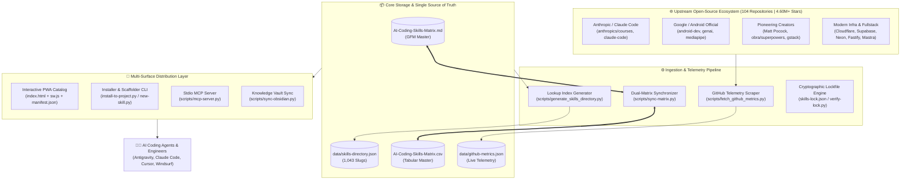
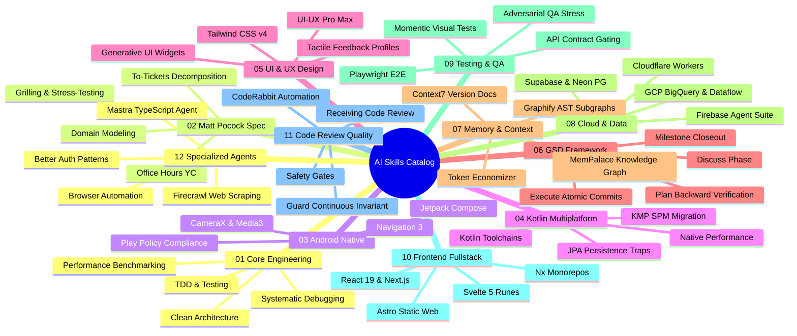
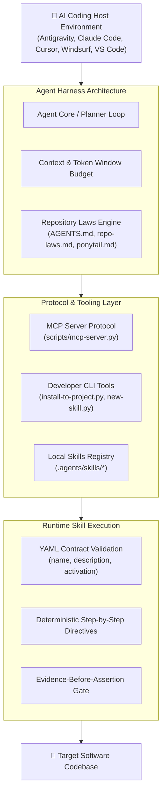
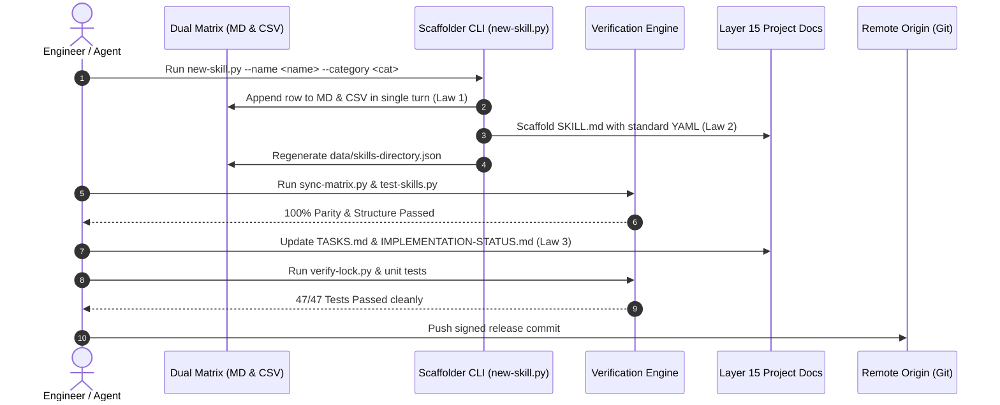

# ECOSYSTEM-MAP.md — Visual Architecture & Framework Topology

> **Status:** Authoritative Ecosystem Blueprint  
> **Repository:** `Ai-Models-List`  
> **Catalog Scope:** 317+ Skills | 104 Upstream Repositories | 4.60M+ Community Stars | 12 Domains  
> **Date:** 2026-11-09  

---

## 🧭 Executive Architecture Topology

The `Ai-Models-List` platform functions as a standardized multi-agent runtime ecosystem, cataloging, synchronizing, and serving production-grade AI agent skills to coding assistants. The system guarantees cryptographic integrity, dual-matrix parity, and framework isolation across 104 open-source projects.

---

## 🏛️ The 12 Functional Domains (Taxonomy Map)

---

## 🔄 Multi-Agent Runtime Execution Hierarchy

---

## 📋 Layer 15 Universal Project Documentation Lifecycle

---

## 📊 Domain Catalog Reference

| Domain Index | Canonical Domain Name | Upstream Anchor Projects | Active Skills | Default Scoped Prefix |
| :---: | :--- | :--- | :---: | :--- |
| `01` | Core Engineering | `obra/superpowers`, `garrytan/gstack` | 24 | `/core-` or `/superpowers-` |
| `02` | Matt Pocock Workflow | `mattpocock/skills` | 18 | `/mp-` |
| `03` | Android Native | `google/android-skills` | 32 | `/android-` |
| `04` | Kotlin & KMP | `JetBrains/kotlin`, `google/kmp` | 14 | `/kotlin-` |
| `05` | UI/UX & Design | `nextlevelbuilder/ui-ux-pro-max` | 21 | `/ui-` |
| `06` | GSD (Get Stuff Done) | `gsd-labs/gsd` | 38 | `/gsd-` |
| `07` | Memory & Context | `mempalace`, `graphify`, `context7` | 16 | `/mem-` |
| `08` | Cloud & Data Platforms | `cloudflare`, `supabase`, `neon`, `firebase` | 28 | `/cloud-` |
| `09` | Testing & Verification | `momentic`, `playwright`, `superpowers` | 22 | `/test-` |
| `10` | Frontend & Fullstack | `sveltejs`, `vercel/next.js`, `tailwind` | 34 | `/front-` |
| `11` | Code Review & Quality | `coderabbitai`, `superpowers-review` | 26 | `/review-` |
| `12` | Specialized Agents | `mastra-ai`, `firecrawl`, `better-auth` | 44 | `/special-` |

