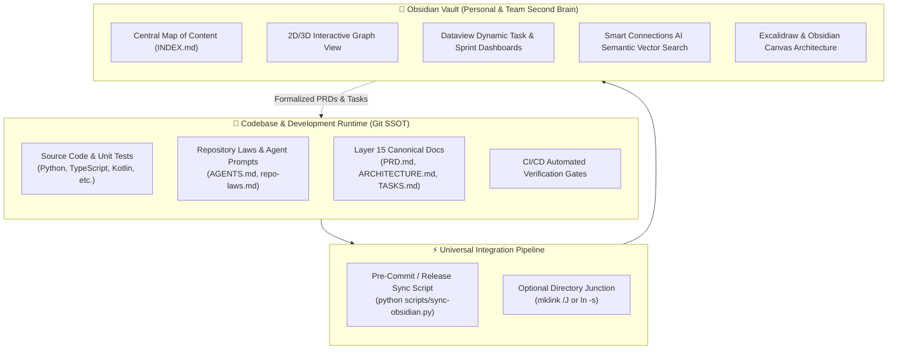

# OBSIDIAN-DEVELOPER-SECOND-BRAIN.md — Universal Obsidian Engineering Specification

> **Specification Tier:** Universal Project Documentation (Layer 15 Architecture)  
> **Status:** Authoritative Standard  
> **Target Audience:** Software Engineers, Tech Leads, and AI Coding Assistants  
> **Date:** 2026-11-09  

---

## 🧭 Executive Architecture & Core Philosophy

Modern software development creates massive **context fragmentation**:
- Code lives in Git repositories.
- Tasks live in Jira, Linear, or GitHub Issues.
- Technical research, architectural decisions, and diagrams live in Google Docs, Notion, or personal notes.
- AI assistant prompts, scratchpads, and agent reasoning transcripts disappear into chat logs.

**Obsidian as a Developer Second Brain** solves this by establishing a **local-first, markdown-native, interconnected knowledge base** that bridges human thinking with automated AI coding workflows.



---

## 🏛️ The Cardinal Law: The Git-First Separation Principle

To prevent corrupted lockfiles, broken unit tests, and git merge hell, all projects adhering to this specification **MUST** enforce the **Git-First Separation Principle**:

| Property | Git Repository Workspace | Obsidian Vault |
| :--- | :--- | :--- |
| **Role** | **Single Source of Truth (SSOT)** & Execution Engine | **Visual Reading Surface, Graph Map & Brain** |
| **Authority** | Code, tests, build scripts, lockfiles, release commits | Personal study notes, reading, visual dashboards |
| **Verification** | Python/Node linters, pre-commit hooks, CI/CD | Human visual review, Dataview queries |
| **Direction** | Upstream Master | Downstream Mirror |

> [!CAUTION]
> **Never edit code, lockfiles (`skills-lock.json`), or dual-matrix files directly inside Obsidian.**  
> Edits must be made in the repository where automated pre-commit hooks and unit tests validate syntax and parity before syncing to Obsidian.

---

## 🔄 The 4 Universal Integration Modes (Choose for Your Project)

Depending on your team size, repository security, and platform constraints, choose one of these 4 integration modes:

### Mode 1: Automated Sync Script (Recommended for Production & CI)
* **How it works:** A Python or Bash script (`scripts/sync-obsidian.py`) copies canonical markdown documents from `docs/` and matrix files to the Obsidian vault on every commit or release.
* **Pros:** 100% collision-safe; zero chance of an Obsidian plugin accidentally corrupting Git state or lockfiles.
* **Cons:** Changes made in Obsidian do not automatically flow back to Git without manual backporting.
* **Setup:**
  ```python
  # scripts/sync-obsidian.py
  import shutil
  from pathlib import Path

  REPO_ROOT = Path(__file__).resolve().parent.parent
  VAULT_PROJECT = Path(r"D:\ObsidianVault\Vault1\ObsidianVault\01_Projects\AI-Ecosystem\Ai-Models-List")

  # Mirror docs
  shutil.copy2(REPO_ROOT / "AI-Coding-Skills-and-Tools-Matrix.md", VAULT_PROJECT / "AI-Coding-Skills-and-Tools-Matrix.md")
  ```

---

### Mode 2: Directory Junction / Symlink (Zero-Copy Live Two-Way Editing)
* **How it works:** The target project's `docs/` folder is linked directly into the Obsidian vault via an OS-level directory junction or symlink.
* **Pros:** True zero-copy real-time editing. Any edit made in Obsidian is immediately reflected in the repo's `docs/` folder and vice versa.
* **Cons:** Requires discipline; only markdown documentation files should be symlinked, never active code or `.git/`.
* **Setup (Windows Command Prompt - Admin):**
  ```cmd
  mklink /J "D:\ObsidianVault\Vault1\ObsidianVault\01_Projects\MyProject" "D:\Codes\MyProject\docs"
  ```
* **Setup (macOS / Linux):**
  ```bash
  ln -s "/path/to/my-project/docs" "/path/to/vault/01_Projects/MyProject"
  ```

---

### Mode 3: Git-Submodule Monorepo Vault
* **How it works:** The Obsidian vault itself is a Git repository, and each software project's documentation branch is attached as a Git Submodule.
* **Pros:** Fully distributed; compatible with `obsidian-git` plugin for scheduled background pushes.
* **Cons:** Git submodules require git plumbing expertise (`git submodule update --remote`).

---

### Mode 4: Headless AI Agent Bridge (Local REST API & MCP)
* **How it works:** Obsidian runs the community plugin **Local REST API** (HTTPS on port 27124) or an MCP server. AI agents (Antigravity, Claude Code, Cursor) query notes, read canvas boards, and search markdown directly via tool calls.
* **Pros:** Turns your entire Obsidian vault into external memory for AI coding agents.

---

## 📁 Standardized Vault Hierarchy (`01_Projects` Architecture)

To prevent platform-specific nesting issues (e.g. non-Android projects trapped inside an `Android/` folder), adopt the **Categorized Projects Standard**:

```
MyVault/
├── 📁 01_Projects/                     # All software engineering projects
│   ├── 📁 AI-Ecosystem/               # AI models, agents, catalogs, MCP servers
│   │   └── 📁 Ai-Models-List/
│   ├── 📁 Mobile-Android/              # Android apps, KMP shared modules
│   │   ├── 📁 Intercom-Alpha/
│   │   └── 📁 Trackense/
│   ├── 📁 Web-Fullstack/               # Next.js, SvelteKit, Astro web apps
│   └── 📁 Systems-Backend/             # Rust, Go, Python API microservices
├── 📁 02_Tasks_and_Sprints/            # Global task rollups & kanban boards
├── 📁 03_Whiteboards_and_Canvas/       # Excalidraw system architecture diagrams
├── 📁 04_Knowledge_Hub/                # Tech stacks, languages, RFCs, cheat sheets
└── 📁 05_Templates/                    # Templater templates for PRD, ADR, Sprint Review
```

---

## ⚡ Automated Git Pre-Commit Hook Integration

To ensure your Obsidian vault is never out of date, wire the sync script into your repository's `.git/hooks/pre-commit`:

```bash
#!/usr/bin/env bash
# .git/hooks/pre-commit

echo "[*] Running Obsidian Vault sync..."
python scripts/sync-obsidian.py

if [ $? -ne 0 ]; then
  echo "[FAIL] Obsidian sync failed! Aborting commit."
  exit 1
fi
```

