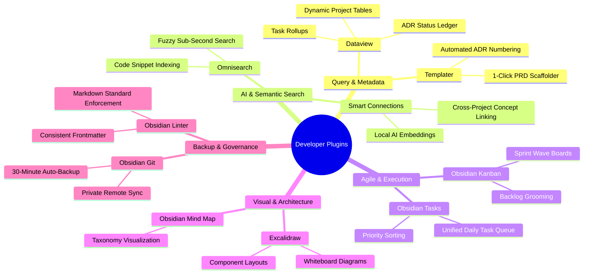

# OBSIDIAN-PLUGINS-FOR-DEVELOPERS.md — Plugin Orchestration & Engineering Workflows

> **Standard:** Universal Developer Second Brain (Layer 15 Plugin Suite)  
> **Target Audience:** Developers, Tech Leads, and AI Coding Engineers  
> **Vault Compatibility:** Obsidian v1.6+ | Desktop & Mobile  
> **Date:** 2026-11-09  

---

## 🛠️ The Developer's Top 10 Plugin Stack

Your vault is equipped with a high-performance suite of community plugins. Here is how to configure and orchestrate them for maximum engineering velocity:



---

## 📊 1. Dataview: Copy-Pasteable Engineering Dashboards

### A. All-Projects Health Matrix
Paste this into your vault's `INDEX.md` or a central `Projects Dashboard.md` note:

````markdown
```dataview
TABLE 
  platform AS "Platform / Domain",
  priority AS "Priority",
  status AS "Lifecycle Status",
  file.mtime AS "Last Modified"
FROM "01_Projects"
WHERE file.name != "INDEX"
SORT file.mtime DESC
```
````

### B. Global Sprint Tasks Aggregator
Collects all uncompleted tasks across all project notes without leaving your dashboard:

````markdown
```dataview
TASK
FROM "01_Projects"
WHERE !completed
GROUP BY file.link
SORT file.mtime DESC
```
````

### C. Architecture Decision Record (ADR) Ledger
Tracks all architectural choices made across codebases:

````markdown
```dataview
TABLE
  status AS "Status",
  date AS "Decided Date",
  context AS "Decision Context"
FROM "01_Projects"
WHERE contains(file.tags, "#adr") OR contains(file.folder, "adr")
SORT file.name ASC
```
````

---

## ⚡ 2. Templater: Automated Document Generators

With `templater-obsidian`, you can scaffold production-grade Layer 15 documents with dynamic dates, project names, and prompts.

### A. Dynamic ADR Generator (`Templates/ADR-Template.md`)
```markdown
<%*
let title = await tp.system.prompt("Enter Architecture Decision Title:");
let adrNum = tp.date.now("YYYYMMDD-HHmm");
-%>
---
title: "<% title %>"
date: <% tp.date.now("YYYY-MM-DD") %>
status: "PROPOSED"
tags:
  - adr
  - architecture
---

# ADR-<% adrNum %>: <% title %>

## Status
- [ ] PROPOSED
- [ ] ACCEPTED
- [ ] SUPERSEDED

## Context & Problem Statement
What is the architectural context and technical constraint driving this decision?

## Considered Options
1. **Option 1**: [Description]
2. **Option 2**: [Description]

## Decision Outcome
Chosen Option: **Option 1**, because:
- Trade-off analysis...
- Security and compliance invariants...

## Consequences
- **Positive**: [Benefit]
- **Negative / Risks**: [Trade-off]
```

---

## 🧠 3. Smart Connections: AI Semantic Vector Search

`smart-connections` provides local or API-driven vector embeddings across your entire vault.

### Best Configuration for Developers:
1. **Embedding Model**: Use local BAAI/bge-micro-v2 (runs 100% offline, zero API fees).
2. **Exclusion Filters**:
   - Exclude `.git/`, `.makemd/`, `.smart-env/`, and temporary folders to keep embeddings clean.
3. **Usage Pattern**:
   - While viewing an architecture note for `Ai-Models-List`, open the Smart Connections sidebar.
   - It will automatically display related notes in `Intercom-Alpha` or `TRE4.0` that share concepts (e.g. `WebSocket streaming`, `TDD`, or `Lockfiles`), revealing cross-project architectural insights.

---

## 💾 4. Obsidian Git: Hands-Off Version Control

`obsidian-git` turns your entire vault into a private, versioned git repository.

### Recommended Production Settings:
- **Auto-Backup Interval**: Every 30 minutes (`Vault backup interval: 30`).
- **Commit Message Format**: `vault backup: {{date}} (auto)`
- **Auto-Pull on Startup**: Enabled (keeps desktop and laptop in sync).
- **Remote Host**: Private GitHub or GitLab repository with Personal Access Token (PAT).

---

## 🎯 5. Curated Additional Plugins for Advanced Software Engineering

If you wish to expand your vault further, these highly rated open-source plugins complement your existing stack:

| Plugin Name | Why It Is Useful for Developers |
| :--- | :--- |
| **Obsidian Local REST API** | Exposes a secure HTTPS REST API (port 27124) allowing AI agents (Antigravity, Claude Code, Cursor) to read and search your vault directly. |
| **Paste URL into Selection** | Highlights text, presses `Ctrl+V`, and instantly converts it to `[text](url)` without manual markdown typing. |
| **Code Styler** | Adds syntax highlighting, line numbers, and copy buttons to code blocks inside notes. |
| **Mermaid Tools** | Visual UI buttons to insert and validate Mermaid sequence, flowchart, and class diagrams. |
