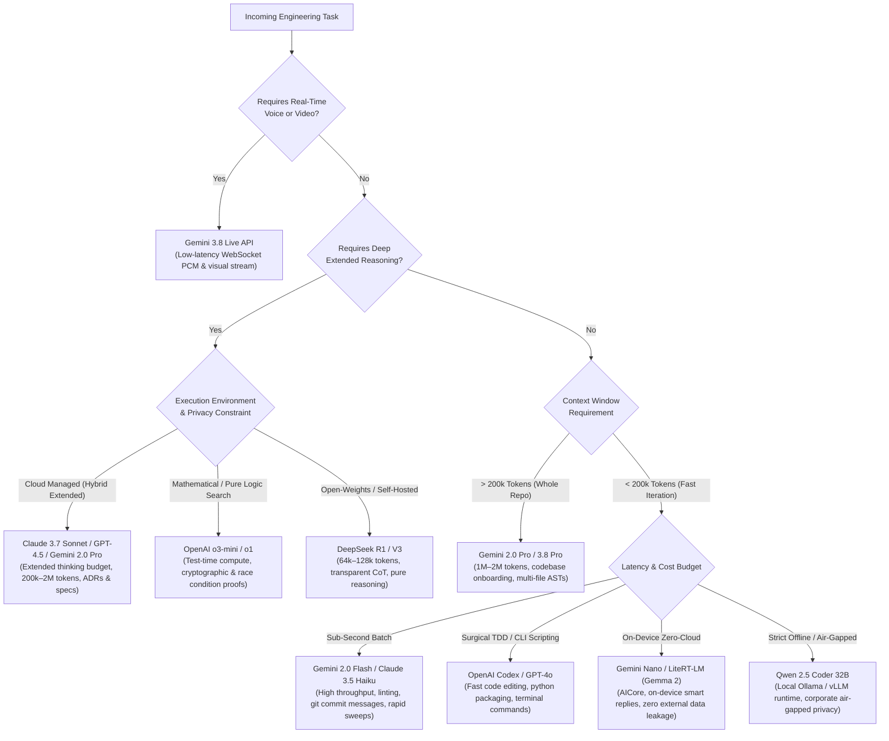
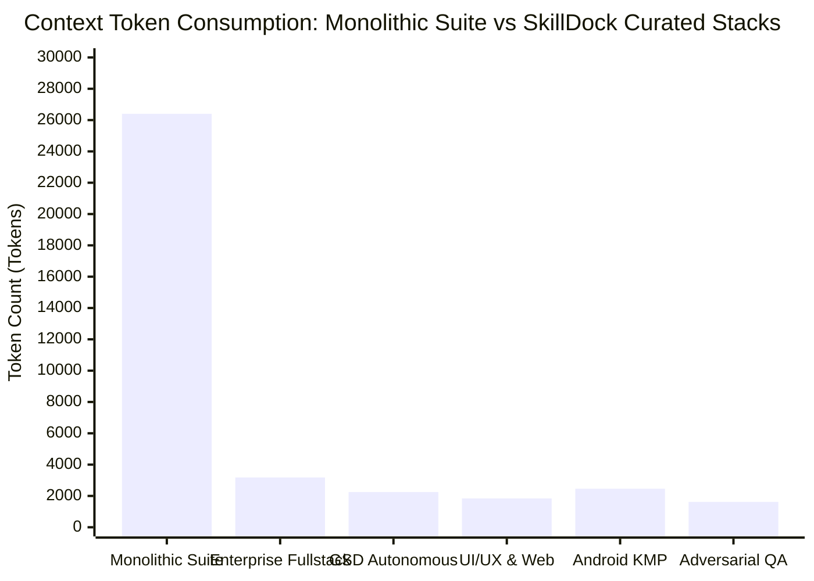

# Frontier AI Model Selection & Routing Matrix

An authoritative architectural guide for routing engineering tasks to the optimal AI models based on reasoning depth, context capacity, latency budgets, cost economics, and specialized modalities across **332+ cataloged skills**, **118 upstream frameworks**, and **5.12M+ community stars**.

---

## 🧭 Model Selection Decision Flowchart



---

## 📊 Frontier Model Capability Matrix

| Model Tier | Flagship Models | Reasoning Architecture | Context Window | Sweet Spot Workflows | Best Paired Skills & Suites |
| :--- | :--- | :--- | :--- | :--- | :--- |
| **Architect & Deep Planner** | **Claude 3.7 Sonnet**<br>`claude-3-7-sonnet` | Hybrid Instant + Extended Thinking | 200k tokens | Complex multi-module architecture, ADR generation, deep code review, Layer 15 documentation, strict negative constraints. | `writing-plans`, `domain-modeling`, `code-review`, `to-spec`, `gsd-core` |
| **Advanced Reasoning & Synthesis** | **GPT-4.5**<br>`gpt-4.5-preview` | Deep Multimodal World Knowledge & High-Fidelity Synthesis | 128k tokens | High-level system strategy, executive review, complex multi-discipline code synthesis, cross-language transpilations. | `plan-ceo-review`, `plan-eng-review`, `architecture`, `brd` |
| **Complex Math & Algorithmic Search** | **OpenAI o3-mini / o1**<br>`o3-mini` / `o1` | Test-Time Compute Tree Search | 200k tokens | Low-level bitwise operations, cryptographic algorithms, concurrency edge cases, deadlock proofs, compiler AST transforms. | `systematic-debugging`, `investigate`, `tsd`, `ssd`, `qa` |
| **Multimodal & Long-Context Frontier** | **Gemini 2.0 Pro / 3.8 Pro**<br>`gemini-2.0-pro` / `gemini-3.8-pro` | Native Multimodal Reasoning | 1M–2M tokens | Massive monorepo codebase indexing, visual UI layout inspection, full-trace ANR diagnostics, video screen recording analysis. | `graphify`, `gsd-onboard`, `camerax`, `anr-audit-and-fix`, `edge-to-edge` |
| **High-Throughput Daily Driver** | **Gemini 2.0 Flash / 3.8 Flash**<br>`gemini-2.0-flash` | Optimized Low-Latency Inference | 1M tokens | Fast iterative editing, test generation, git commit message authoring, inline documentation, batch linting, agent tool loop routing. | `systematic-debugging`, `executing-plans`, `setup-pre-commit`, `tokeneconomizer` |
| **Real-Time Streaming Intercom** | **Gemini 3.8 Live**<br>`gemini-live-api` | Bidirectional Audio/Video WebSocket | Real-time PCM stream | Bidirectional real-time voice intercom, live terminal narration, pair programming audio session, UI screen mirroring. | `gemini-live-api-dev`, `VoiceModel`, `Intercom-Alpha` |
| **Open-Weights Frontier Reasoning** | **DeepSeek R1 / V3**<br>`deepseek-reasoner` | Large-Scale RL Reasoning Engine | 64k–128k tokens | Transparent chain-of-thought verification, cost-efficient mathematical verification, open-source stack integration. | `tdd`, `test-strategy`, `qa`, `benchmark`, `benchmark-report` |
| **Code Generation & CLI Mastery** | **OpenAI Codex / GPT-4o**<br>`gpt-4o` | Dense Autoregressive Transformer | 128k tokens | General multi-language scripting, Python packaging, terminal automation scripts, shell workflow generation, fast patches. | `codex`, `agent-browser`, `wiggum-cli`, `openhands` |
| **On-Device Edge Models** | **Gemini Nano / Gemma 2**<br>`litert-lm` | Small-Scale Quantized INT4/8 | 4k–8k tokens | On-device private summarization, text extraction, edge smart replies with zero cloud latency and zero network reliance. | `ml-kit-genai-prompt-api`, `mlkit-agent-api`, `litert-runtime` |
| **Local Offline Specialist** | **Qwen 2.5 Coder 32B**<br>`ollama / vllm` | Open-Weights Dense Transformer | 32k–64k tokens | Complete offline privacy, air-gapped corporate codebases, zero external data leakage, local terminal execution. | `careful`, `tdd`, `guard`, `rules` |

---

## 🧠 Frontier Reasoning Architectures: Deep Comparison

### 1. Claude 3.7 Sonnet (Hybrid Thinking)
- **Architecture**: Novel hybrid paradigm that allows callers to toggle seamlessly between standard low-latency responses and deep chain-of-thought exploration (variable thinking budget up to 64k tokens).
- **Core Strengths**: 
  - Superhuman instruction adherence and fidelity to **negative constraints** (e.g., "Do not alter public interface contracts").
  - Multi-file architectural consistency across large refactorings.
  - Zero hallucination of fictitious SDK methods or deprecated flags.
- **Ideal Workflows**: Staff engineer planning (`/plan-eng-review`), domain modeling, security audits, and Layer 15 project specification authoring.

### 2. DeepSeek R1 (Open-Weights Pure Reinforcement Learning)
- **Architecture**: Pure reinforcement learning reasoning engine that exposes explicit `<think>` scratchpads natively.
- **Core Strengths**: 
  - Uncompromising mathematical and algorithmic rigor.
  - Relentless discovery of subtle off-by-one errors, floating-point traps, and boundary condition failures.
  - Free and open weights enabling air-gapped, zero-cloud corporate deployments.
- **Ideal Workflows**: Test-Driven Development (TDD), property-based test harness design, performance benchmarking, and algorithmic complexity verification.

### 3. OpenAI o3-mini (Test-Time Compute Search)
- **Architecture**: Compact, highly-optimized test-time compute search model with selectable reasoning effort (`low`, `medium`, `high`).
- **Core Strengths**: 
  - Sub-second first-token latency in low reasoning mode with deep logic verification in high reasoning mode.
  - High density of correct code generation per unit cost.
- **Ideal Workflows**: Tricky concurrency bugs, race condition analysis, state-machine transitions, and low-level system programming.

### 4. Gemini 2.0 Pro / Flash (Frontier Multimodal Native)
- **Architecture**: Native multimodal foundation model with 2,097,152 token context window and synchronized audio/video/text tokens.
- **Core Strengths**: 
  - Ingesting entire codebases (50,000+ lines) in a single turn without vector truncation.
  - Analyzing user-submitted video recordings and screenshot sequences to catch subtle visual layout shifts.
- **Ideal Workflows**: Greenfield onboarding (`gsd-onboard`), Android CameraX / Compose preview debugging, and massive monorepo refactoring.

---

## 🎯 Domain-to-Model Routing Rules (All 12 Categories)

| Category | Recommended Primary Model | Recommended Secondary / Fallback | Rationale | Essential Skills |
| :--- | :--- | :--- | :--- | :--- |
| **01 Core Engineering** | **Claude 3.7 Sonnet** | **GPT-4.5** | High rigor on architectural boundaries, clean interfaces, and refactoring patterns. | `codebase-design`, `improve-codebase-architecture`, `systematic-debugging` |
| **02 Matt Pocock** | **Claude 3.7 Sonnet** | **Gemini 2.0 Pro** | Conversational requirement gathering, domain modeling, and triage label classification. | `ask-matt`, `domain-modeling`, `triage`, `to-spec` |
| **03 Android** | **Gemini 2.0 Pro / Flash** | **Claude 3.7 Sonnet** | Native alignment with Google Android platform, Compose, AGP 9, Navigation 3, and CameraX. | `navigation-3`, `jetpack-compose-performance`, `camerax`, `edge-to-edge` |
| **04 Kotlin / KMP** | **Gemini 2.0 Flash** | **Claude 3.7 Sonnet** | Modern Kotlin toolchains, multiplatform targets, and Gradle build script optimizations. | `kotlin-tooling-kotlin-toolchain`, `kotlin-tooling-agp9-migration`, `kotlin-tooling-native-build-performance` |
| **05 UI / UX Design** | **Claude 3.7 Sonnet** | **Gemini 2.0 Flash** | Flawless token scales, typography hierarchies, anti-slop rules, and WCAG contrast checks. | `taste-skill`, `ui-taste`, `ui-ux-pro-max`, `unslop`, `impeccable` |
| **06 GSD Framework** | **Claude 3.7 Sonnet** | **DeepSeek R1** | Goal-backward planning, atomic wave execution, and strict verification checkpoints. | `gsd-core`, `gsd-plan-phase`, `gsd-execute-phase`, `gsd-verify-work` |
| **07 Agent Architecture** | **Claude 3.7 Sonnet** | **Gemini 2.0 Pro** | Harness orchestration, subagent delegation protocols, and context isolation. | `swarm`, `dispatching-parallel-agents`, `subagent-driven-development` |
| **08 Cloud & Data Platforms** | **Claude 3.7 Sonnet** | **OpenAI Codex** | Serverless edge runtimes, connection pool topologies, and zero-downtime database schemas. | `neon-serverless-postgres`, `better-auth-patterns`, `prisma-orm-patterns` |
| **09 Testing & Verification** | **DeepSeek R1 / o3-mini** | **Claude 3.7 Sonnet** | Adversarial edge testing, race-condition reproduction, and empirical benchmarks. | `tdd`, `test-driven-development`, `qa`, `benchmark`, `momentic-visual-testing` |
| **10 Frontend & Fullstack** | **Gemini 2.0 Flash** | **Claude 3.7 Sonnet** | Reactive state idioms (Svelte 5 runes, React 19 hooks) and rapid component authoring. | `svelte5-runes-patterns`, `modern-web-guidance`, `nx-monorepo-architect` |
| **11 Code Review Quality** | **Claude 3.7 Sonnet** | **CodeRabbit AST** | Detection of BOLA/IDOR, injection risks, memory leaks, and repository law violations. | `code-review`, `coderabbit`, `guard`, `careful` |
| **12 Specialized Domains** | **Gemini 3.8 Live / Nano** | **Claude 3.7 Sonnet** | Real-time WebSocket audio/video streaming, LiteRT on-device models, and specialized protocols. | `gemini-live-api-dev`, `ml-kit-genai-prompt-api`, `projected-hardware` |

---

## 💰 Empirical Token Budget Guidelines & Economics

A critical advantage of SkillDock v3.0 is **selective stack compilation** versus indiscriminate monolithic skill dumping. Monolithic agent prompts inject dozens of unused rules into context, inflating latency and cost while diluting model attention.

### Monolithic vs Selective Stack Benchmark



### Empirical Cost & Token Savings Matrix

| Deployment Strategy | Active Skills | Token Footprint (Prompt) | Cost / 1,000 Turns (Claude 3.7 Sonnet @ $3/M) | Cost / 1,000 Turns (Gemini 2.0 Flash @ $0.10/M) | Token Reduction |
| :--- | :---: | :---: | :---: | :---: | :---: |
| **Monolithic Full Dump** (All 332 Skills) | 332 | **~26,400 tokens** | **$79.20** | **$2.64** | Baseline (0%) |
| **Enterprise Fullstack Pack** | 6 | **~3,180 tokens** | **$9.54** | **$0.32** | **87.9% Savings** |
| **GSD Autonomous Wave Suite** | 5 | **~2,250 tokens** | **$6.75** | **$0.22** | **91.5% Savings** |
| **UI/UX & Anti-Slop Stack** | 4 | **~1,840 tokens** | **$5.52** | **$0.18** | **93.0% Savings** |
| **Android & Kotlin KMP Pack** | 5 | **~2,460 tokens** | **$7.38** | **$0.25** | **90.7% Savings** |
| **Adversarial QA & Security Stack** | 4 | **~1,620 tokens** | **$4.86** | **$0.16** | **93.8% Savings** |

### Context Window Optimization Principles:
1. **Never Inject Inactive Creators**: Follow **Law 4**. If executing a GSD wave, do not load Superpowers or Matt Pocock skills simultaneously.
2. **Selective Stack Hydration**: Use the SkillDock URL scheme (`?stack=taste-skill,unslop,systematic-debugging`) or WebMCP bridge to load only the 3–6 skills essential to the active sprint.
3. **Evidence Before Assertions**: Allocate 20% of the token budget to reasoning scratchpads and empirical test outputs (`python -m unittest`, `npx playwright test`) rather than narrative text.

---

## 🔌 Universal MCP & WebMCP Agent Integration

Frontier models connect to the SkillDock ecosystem through two standard mechanisms:

### 1. Terminal Stdio MCP Server (Claude Code, Cursor, Windsurf)
Add to your project's `.mcp.json` or global configuration:
```json
{
  "mcpServers": {
    "skilldock": {
      "command": "python",
      "args": ["d:/Codes/Antigravity/Project4/Ai-Models-List/scripts/mcp-server.py"]
    }
  }
}
```

### 2. Client-Side WebMCP Bridge (DevTools & Browser Agents)
Any browser automation agent (Playwright, Puppeteer, Claude Computer Use) can execute tool calls against the live DOM:
```javascript
// Search skills dynamically from the active browser tab
const results = await window.__SKILLDOCK_MCP__.callTool("search_skills", {
  query: "taste-skill",
  limit: 5
});
console.log(JSON.parse(results.content[0].text));
```

### Supported JSON-RPC Tool Capabilities:
1. `search_skills`: Search across all 332 skills by keyword, category, or priority.
2. `get_skill`: Retrieve full `SKILL.md` rules and CLI recipes with zero disk latency.
3. `list_frameworks`: Explore all 118 upstream framework harnesses.
4. `get_starter_packs`: Retrieve curated starter stacks.
5. `get_stack` / `add_to_stack` / `clear_stack`: Manage user stacks programmatically.
6. `export_stack_cli`: Export stack commands tailored for Antigravity, Claude Code, Codex, or Git CLI.
