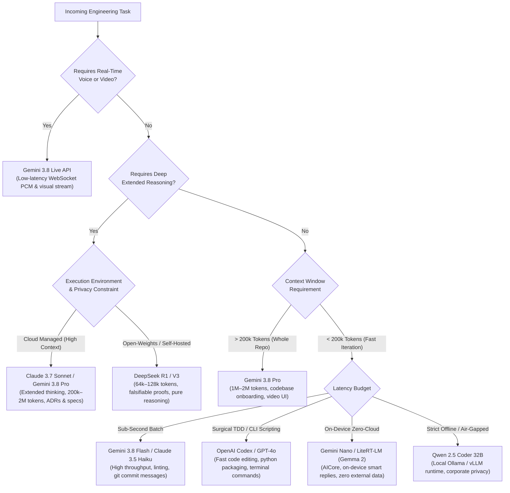

# Frontier AI Model Selection & Routing Matrix

An authoritative architectural guide for routing engineering tasks to the optimal AI models based on reasoning depth, context capacity, latency budgets, and specialized modalities across **317+ cataloged skills**, **104 upstream frameworks**, and **4.60M+ community stars**.

---

## 🧭 Model Selection Decision Flowchart



---

## 📊 Frontier Model Capability Matrix

| Model Tier | Flagship Models | Reasoning Architecture | Context Window | Sweet Spot Workflows | Best Paired Skills |
| :--- | :--- | :--- | :--- | :--- | :--- |
| **Architect & Deep Planner** | **Claude 3.7 Sonnet**<br>`claude-3-7-sonnet` | Hybrid Instant + Extended Thinking | 200k tokens | Complex multi-module architecture, ADR generation, deep code review, Layer 15 documentation. | `writing-plans`, `domain-modeling`, `code-review`, `to-spec` |
| **Multimodal & Long-Context** | **Gemini 3.8 Pro**<br>`gemini-3.8-pro` | Multimodal Frontier Reasoning | 1M–2M tokens | Massive repository indexing, full-video UI inspection, cross-repo dependency analysis, codebase onboarding. | `graphify`, `gsd-onboard`, `ui-ux-pro-max`, `camerax` |
| **High-Throughput Daily Driver** | **Gemini 3.8 Flash**<br>`gemini-3.8-flash` | Optimized Low-Latency Inference | 1M tokens | Fast iterative editing, test generation, git commit message authoring, inline documentation, batch linting. | `systematic-debugging`, `executing-plans`, `setup-pre-commit` |
| **Real-Time Streaming** | **Gemini 3.8 Live**<br>`gemini-live-api` | Bidirectional Audio/Video WebSocket | Real-time stream | Bidirectional real-time voice intercom, live terminal narration, pair programming audio session, UI screen mirroring. | `gemini-live-api-dev`, `VoiceModel`, `Intercom-Alpha` |
| **Open-Weights Frontier Reasoning** | **DeepSeek R1 / V3**<br>`deepseek-reasoner` | Large-Scale RL Reasoning Engine | 64k–128k tokens | Transparent chain-of-thought verification, cost-efficient mathematical verification, open-source stack integration. | `tdd`, `test-strategy`, `qa`, `benchmark` |
| **Complex Math & Algorithmic Logic** | **OpenAI o3-mini / o1**<br>`o3-mini` / `o1` | Test-Time Compute Search | 200k tokens | Low-level bitwise operations, cryptographic algorithms, tricky concurrency bugs, race condition analysis. | `systematic-debugging`, `tsd`, `ssd`, `investigate` |
| **Code Generation & CLI** | **OpenAI Codex / GPT-4o**<br>`gpt-4o` | Dense Autoregressive Transformer | 128k tokens | General multi-language scripting, Python packaging, terminal automation scripts, shell workflow generation. | `codex`, `managing-python-dependencies`, `agent-browser` |
| **On-Device Edge Models** | **Gemini Nano / Gemma 2**<br>`litert-lm` | Small-Scale Quantized INT4/8 | 4k–8k tokens | On-device private summarization, text extraction, edge smart replies with zero cloud latency. | `ml-kit-genai-prompt-api`, `mlkit-agent-api`, `litert-runtime` |
| **Local Offline Specialist** | **Qwen 2.5 Coder 32B**<br>`ollama / vllm` | Open-Weights Dense Transformer | 32k–64k tokens | Complete offline privacy, air-gapped corporate codebases, zero external data leakage, local terminal execution. | `accidental-data-loss-prevention`, `tdd`, `careful` |

---

## 🧠 Deep Reasoning Framework Comparison: Claude 3.7 Sonnet vs DeepSeek R1

### Claude 3.7 Sonnet (Hybrid Thinking)
- **Architecture**: Supports a variable thinking budget allowing callers to toggle dynamically between standard low-latency responses and deep chain-of-thought exploration (up to 64k thinking tokens).
- **Primary Strength**: Adherence to structural constraints, negative constraints (e.g., "Do not modify existing interfaces"), and multi-file architectural refactoring without hallucinating APIs.
- **Ideal For**: Staff engineer planning (`/plan-eng-review`), domain modeling, security audits, and Layer 15 project specification authoring.

### DeepSeek R1 (Open-Weights Reinforcement Learning)
- **Architecture**: Pure reinforcement-learning trained model displaying explicit, transparent `<think>` traces.
- **Primary Strength**: Extreme mathematical and algorithmic rigor, uncovering subtle off-by-one errors, floating-point traps, and edge conditions in falsifiable tests.
- **Ideal For**: Test-Driven Development (TDD), property-based testing, performance benchmarking, and air-gapped on-premise deployments where API calls to external providers are prohibited.

---

## 🎯 Task-to-Model Routing Rules by Domain

### 1. Requirements Discovery & Specification (`02 Matt Pocock` & `06 GSD`)
- **Primary**: Claude 3.7 Sonnet or Gemini 3.8 Pro.
- **Why**: High resistance to hallucinating unrequested features; superior adherence to negative constraints; handles long conversational interview transcripts without losing context.

### 2. Android & Kotlin/KMP Development (`03 Android` & `04 Kotlin/KMP`)
- **Primary**: Gemini 3.8 (Pro/Flash) paired with `Context7` or official Android Skills.
- **Why**: Deep native alignment with modern Android APIs (Navigation 3, Compose multi-backstack, AGP 9, LiteRT, CameraX).

### 3. UI/UX Design System Synthesis (`05 UI/UX Design`)
- **Primary**: Claude 3.7 Sonnet or Gemini 3.8 Flash paired with `ui-ux-pro-max` and `taste-skill`.
- **Why**: Flawless generation of cohesive design tokens, typography scales, tactile micro-interactions, and WCAG 2.1 AA contrast assertions.

### 4. Cloud, Backend & Serverless Infrastructure (`08 Cloud & Data Platforms`)
- **Primary**: Claude 3.7 Sonnet or OpenAI Codex paired with `cloudflare-workers-expert`, `supabase-patterns`, or `neon-serverless-postgres`.
- **Why**: Deep familiarity with edge worker execution limits, connection pooling, cold starts, and distributed schema migrations.

### 5. Automated Testing & Verification (`09 Testing & Verification`)
- **Primary**: DeepSeek R1 or Claude 3.7 Sonnet paired with `tdd`, `qa`, and `momentic-visual-testing`.
- **Why**: Relentless adversarial thinking that devises edge-case test vectors, race-condition harnesses, and boundary null tests.

### 6. Frontend & Fullstack Frameworks (`10 Frontend & Fullstack`)
- **Primary**: Gemini 3.8 Flash or Claude 3.7 Sonnet paired with `svelte5-runes-patterns`, `react-nextjs-patterns`, or `tailwind-v4-mastery`.
- **Why**: High token velocity with strict adherence to modern reactive paradigms (Svelte 5 runes, React Server Components).

### 7. Security Review & Pre-Commit Audit (`11 Code Review Quality`)
- **Primary**: Claude 3.7 Sonnet or CodeRabbit AST parser.
- **Why**: Ruthless identification of BOLA/IDOR, SQL injection, missing CSRF tokens, leaked API credentials, and insecure deserialization.

---

## 🔌 Universal Model Context Protocol (MCP) Integration

Any frontier model running inside an MCP-compatible host (Claude Code, Antigravity, Cursor, Windsurf, Claude Desktop) can connect directly to the catalog via our zero-dependency stdio server:

```json
{
  "mcpServers": {
    "ai-coding-skills": {
      "command": "python",
      "args": ["d:/Codes/Antigravity/Project4/Ai-Models-List/scripts/mcp-server.py"]
    }
  }
}
```

### Supported MCP Capabilities:
1. `search_skills`: Dynamic semantic keyword, priority, and ecosystem search across **317+ cataloged skills**.
2. `get_skill`: Instant zero-latency loading of `SKILL.md` rules and workflows directly into the model's active context window.
3. `list_presets`: Rapid exploration of curated multi-agent bundles (`superpowers`, `gstack`, `mattpocock`, `docs`, `core-eng`, `cloud`, `agents`, `uiux`, `testing`).
4. `get_upstream_metrics`: On-demand query of live community telemetry (**4.60M+ total ⭐**, 104 repositories, latest release tags).
5. `install_skill`: Automatic injection of authentic skill folders into the host workspace via `scripts/install-to-project.py`.
