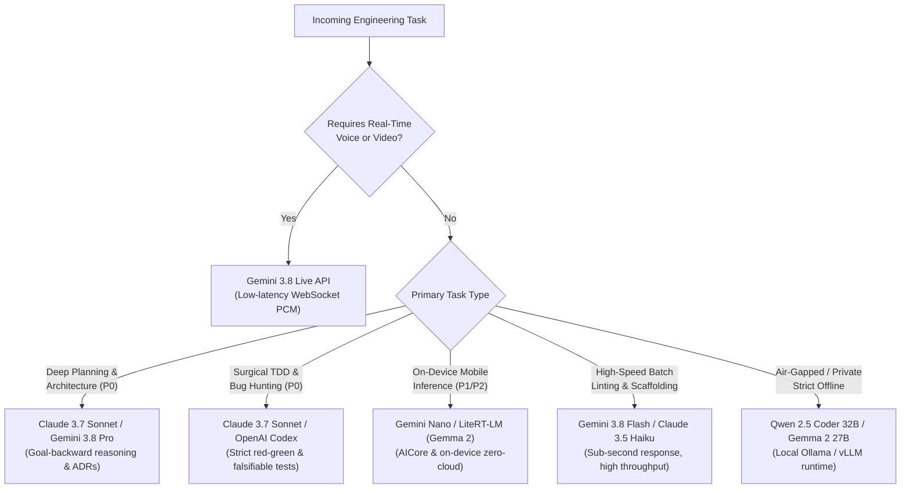

# Frontier AI Model Selection & Routing Matrix

An authoritative architectural guide for routing engineering tasks to the optimal AI models based on reasoning depth, context capacity, latency budgets, and specialized modalities.

---

## 🧭 Model Selection Decision Flowchart

---

## 📊 Frontier Model Capability Matrix

| Model Tier | Flagship Models | Sweet Spot Workflows | Context Window | Best Paired Skills |
| :--- | :--- | :--- | :--- | :--- |
| **Architect & Deep Planner** | **Claude 3.7 Sonnet** `claude-3-7-sonnet` | Complex multi-module architecture, ADR generation, deep code review, Layer 15 documentation. | 200k tokens | `writing-plans`, `domain-modeling`, `code-review`, `to-spec` |
| **Multimodal & Long-Context** | **Gemini 3.8 Pro** `gemini-3.8-pro` | Massive repository indexing, full-video UI inspection, cross-repo dependency analysis. | 1M–2M tokens | `graphify`, `gsd-onboard`, `ui-ux-pro-max`, `camerax` |
| **High-Throughput Daily Driver** | **Gemini 3.8 Flash** `gemini-3.8-flash` | Fast iterative editing, test generation, git commit message authoring, inline documentation. | 1M tokens | `systematic-debugging`, `executing-plans`, `setup-pre-commit` |
| **Real-Time Streaming** | **Gemini 3.8 Live** `gemini-live-api` | Bidirectional real-time voice intercom, live terminal narration, pair programming audio session. | Real-time audio stream | `gemini-live-api-dev`, `VoiceModel`, `Intercom-Alpha` |
| **Code Generation & CLI** | **OpenAI Codex / GPT-4o** `gpt-4o` | General multi-language scripting, Python packaging, terminal automation scripts. | 128k tokens | `codex`, `managing-python-dependencies`, `agent-browser` |
| **On-Device Edge Models** | **Gemini Nano / Gemma 2** `litert-lm` | On-device private summarization, text extraction, edge smart replies with zero cloud latency. | 4k–8k tokens | `ml-kit-genai-prompt-api`, `mlkit-agent-api`, `litert-runtime` |
| **Local Offline Specialist** | **Qwen 2.5 Coder 32B** `ollama / vllm` | Complete offline privacy, air-gapped corporate codebases, zero external data leakage. | 32k–64k tokens | `accidental-data-loss-prevention`, `tdd`, `careful` |

---

## 🎯 Task-to-Model Routing Rules

### 1. Requirements Discovery & Specification (`02 Matt Pocock` & `06 GSD`)
- **Primary**: Claude 3.7 Sonnet or Gemini 3.8 Pro.
- **Why**: High resistance to hallucinating unrequested features; superior adherence to negative constraints ("Do not touch file X").

### 2. Android & Kotlin/KMP Development (`03 Android` & `04 Kotlin/KMP`)
- **Primary**: Gemini 3.8 (Pro/Flash) paired with `Context7` or official Android Skills.
- **Why**: Deep native alignment with modern Android APIs (Navigation 3, Compose multi-backstack, AGP 9, LiteRT).

### 3. UI/UX Design System Synthesis (`05 UI/UX Design`)
- **Primary**: Claude 3.7 Sonnet or Gemini 3.8 Flash paired with `ui-ux-pro-max`.
- **Why**: Flawless generation of cohesive color palettes, typography tokens, and WCAG contrast assertions.

### 4. Security Review & Pre-Commit Audit (`11 Code Review Quality`)
- **Primary**: Claude 3.7 Sonnet or CodeRabbit AST parser.
- **Why**: Ruthless identification of BOLA/IDOR, SQL injection, missing CSRF tokens, and insecure deserialization.

