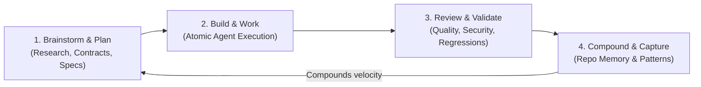

# Compound Engineering Plugin (`everyinc/compound-engineering-plugin`)

> **Priority:** `P0` | **Framework:** `everyinc/compound-engineering-plugin` | **Domain:** `01-core-engineering` | **Stars:** `⭐ 2.8k+`

EveryInc's open-source compound engineering workflow system for Claude Code, Cursor, Codex, and AI coding assistants. It structures software engineering into a continuous 4-phase learning loop where every completed task captures institutional patterns into living repo memory, compounding development speed over time.

---

## When to Use

Activate this skill when:
- Establishing a compounding development methodology where every completed feature makes subsequent tasks faster and less error-prone.
- Architecting and executing multi-step engineering epics requiring rigorous upfront research before touching code.
- Preventing recurring regressions and repeated agent mistakes across development sessions.
- Conducting systematic code comprehension, debugging, and automated pull request generation with visual verification.
- Enforcing agent-native deep-module design standards across teams.

---

## Core Capabilities & Workflow Loop

The Compound Engineering lifecycle organizes work into 4 deterministic phases:



1. **Brainstorm / Plan**:
   - Inspects existing architecture, project documentation, and historical decisions before writing implementation code.
   - Creates actionable, falsifiable task execution waves with explicit acceptance criteria.
2. **Build / Work**:
   - Executes atomic code modifications via specialized sub-agents.
   - Adheres to minimal surgical edits, avoiding speculative abstractions.
3. **Review**:
   - Automatically evaluates diffs against coding standards, performance budgets, and security invariants.
   - Generates automated pull requests enriched with before/after screenshots and test traces.
4. **Compound (Capture)**:
   - **Crucial Step**: Captures architectural findings, root-cause fixes, and reusable patterns directly into repo memory (`CLAUDE.md`, `AGENTS.md`, or `docs/governance/DECISION.md`).
   - Ensures subsequent agent sessions immediately inherit this context, eliminating repetitive instruction.

### Specialized Agent Commands
- `ce-debug`: Systematic hypothesis-driven debugging without speculative trial-and-error patching.
- `ce-explain`: Deep architectural and AST-level codebase comprehension for complex multi-module interactions.
- `ce-pr`: Automated GitHub PR authoring with visual evidence, test pass logs, and risk analysis.

---

## Activation Command

### Interactive Activation
```bash
/compound-engineering
# Or scoped core command:
/core-compound-engineering
```

### Marketplace & IDE Installation
```bash
# Claude Code Marketplace:
/plugin marketplace add EveryInc/compound-engineering-plugin
/plugin install compound-engineering

# Cursor IDE:
/add-plugin compound-engineering

# Open Standard (Linux Foundation):
npx skills add everyinc/compound-engineering-plugin
```

---

## Prerequisites

- Node.js 18+ or Python 3.10+ polyglot development runtime.
- Git repository initialized with living context instructions (`CLAUDE.md`, `AGENTS.md`, or `docs/`).
- GitHub CLI (`gh`) configured for automated PR generation workflows.

---

## Anti-Patterns & Warnings

> [!WARNING]
> - **Skipping the Compound Phase**: Finishing a task without capturing lessons back into repo memory degenerates compound engineering into linear, repetitive toil.
> - **Premature Implementation**: Never jump directly into code generation without completing the Plan phase and verifying domain contracts.
> - **Context Window Pollution**: Do not dump entire repositories into LLM prompts; use targeted graph queries and scoped file ranges to preserve token efficiency.
> - **Speculative Code Abstractions**: Avoid generic wrappers or premature generalization unless explicitly demanded by architecture.

