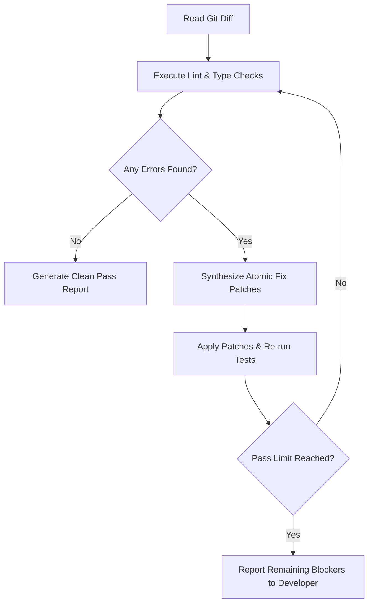

# Continuous Automated Review Loop (`/continuous-review-loop`)

> **Domain:** 03 Code Review and Quality  
> **Upstream Authority:** [`2dmurali/review-loop-skill`](https://github.com/2dmurali/review-loop-skill) (⭐ 7, 110k+ Installs)  
> **Slash Command:** `/continuous-review-loop`

---

## When to Use

* When conducting iterative pre-PR code review cycles that automatically apply fixes and re-verify until zero lint, type, or architectural errors remain.
* When running multi-pass code audits that evaluate code against style guides, security invariants, and test coverage thresholds.
* When verifying complex git diffs before opening pull requests to human maintainers.

## Prerequisites

* Git repository with defined test or lint commands (`npm test`, `pytest`, `cargo test`, etc.).
* Working tree with uncommitted or staged changes.

## Core Capabilities

1. **Iterative Audit & Refine**: Runs consecutive evaluation passes, generating structured patch diffs and applying safe fixes incrementally.
2. **Convergence Termination**: Automatically halts loops upon reaching green status or detects circular repair regressions to avoid infinite oscillations.
3. **Multi-Aspect Analysis**: Evaluates syntax correctness, type safety, OWASP security rules, and performance budgets simultaneously.
4. **Clean PR Report Compilation**: Synthesizes verified improvements and remaining manual considerations into a markdown PR summary.

## Activation Command

```bash
/continuous-review-loop [run|check|iterate] [--max-passes <n>] [--fix]
```

## Workflow & Usage Guide

### 1. Launch Automated Review Loop

```bash
# Run review loop with automated fix passes up to 3 iterations
/continuous-review-loop iterate --max-passes 3 --fix
```

### 2. Convergence Loop Protocol



## Anti-Patterns & Warnings

* **Anti-Pattern:** Unbounded loop limits allowing agents to execute repetitive speculative edits that modify unrelated source code.
* **Anti-Pattern:** Blindly accepting auto-generated fixes that weaken test assertion conditions (e.g., commenting out failing tests) instead of fixing underlying code.
* **Warning:** Always inspect applied patches with `git diff` before pushing to shared upstream branches.
