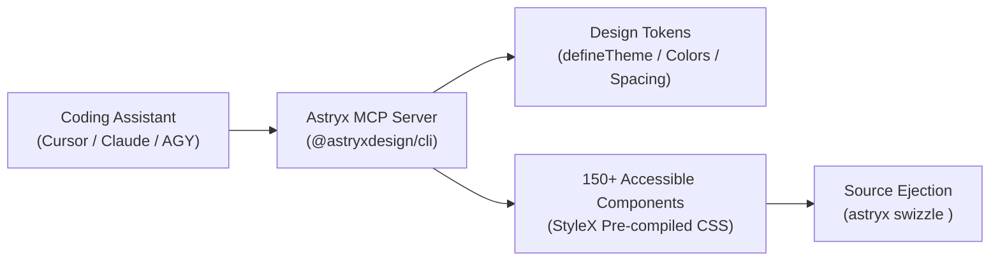

# Astryx — Meta's Agent-Ready Design System

> **Priority**: `P0` | **Category**: `05-ui-ux` | **Upstream**: [`meta/astryx`](https://github.com/meta/astryx) (14.5k+ ⭐)

Astryx is Meta's open-source React design system evolved over eight years powering thousands of applications inside Meta. Built from the ground up for human-AI pair programming, Astryx includes command-line tools, Model Context Protocol (MCP) support, and machine-readable documentation rules so that AI coding assistants (Claude Code, Cursor, Antigravity) accurately scaffold components and look up design tokens without style hallucinations.



---

## When to Use

- Building modern React / Next.js web applications requiring an institutional-grade, accessible component library.
- Pairing with AI coding assistants to design UI without token or CSS style hallucinations.
- When you need theme customizability ranging from simple CSS variables to full component source code ejection (`swizzle`).
- When you want Meta's StyleX engine benefits without build lock-in (ships as typed React components and pre-compiled CSS).

---

## Core Capabilities & Protocols

1. **AI-Agent Ready Architecture**:
   - Ships with an integrated Model Context Protocol (MCP) server so coding agents can query component props, design tokens, and layout guidelines directly.
2. **150+ Accessible React Components**:
   - Comprehensive UI primitives: Buttons, Dialogs, Modals, Data Grids, Forms, Navigation, and Layout grids adhering strictly to WAI-ARIA standards.
3. **Multi-Layer Theming (`defineTheme`)**:
   - Define semantic tokens across light and dark modes with compile-time type safety.
4. **Source Ejection CLI (`swizzle`)**:
   - When a component requires deep modification, run `astryx swizzle <component>` to eject the component source directly into your codebase.

---

## Installation / Activation Command

```bash
# Install Astryx component core and CLI
npm install @astryxdesign/react @astryxdesign/cli

# Initialize Astryx theme and agent rules in your project
npx @astryxdesign/cli init --agent cursor # or antigravity / claude-code

# Start the Astryx MCP server for AI assistants
npx @astryxdesign/cli mcp
```

---

## Prerequisites

- Node.js 18.0.0 or higher.
- React 18 or React 19.
- A modern bundler (Vite, Next.js, Remix, Webpack, or Turbopack).

---

## Anti-Patterns / Warnings

- **Do NOT manually guess CSS classes**: Always query the design token registry via `@astryxdesign/cli` or MCP rather than writing arbitrary utility classes.
- **Do NOT swizzle prematurely**: Use `defineTheme` token overrides before resorting to full source ejection via `swizzle`.
- **Preserve accessibility invariants**: Never remove ARIA labels or focus traps provided out of the box by Astryx dialogs and modals.
