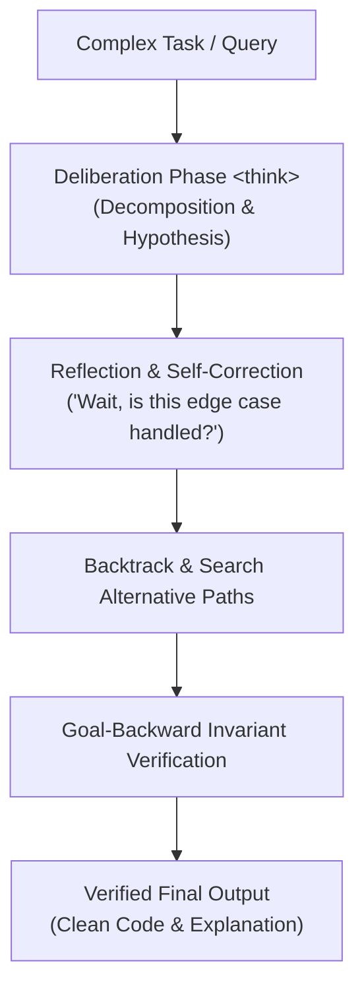

# DeepSeek-R1 Reasoning & Distillation (`deepseek-ai/DeepSeek-R1`)

> **Priority:** `P0` | **Framework:** `deepseek-ai/DeepSeek-R1` | **Domain:** `09-autonomous-agents` | **Stars:** `⭐ 75k+`

Frontier reasoning patterns, chain-of-thought (CoT) verification loops, reflection mechanisms, and reasoning distillation workflows pioneered by DeepSeek-R1. This skill provides system prompts, reflection harnesses, and test strategies for leveraging high-density reasoning tokens to solve complex algorithmic, architectural, and mathematical tasks.

---

## When to Use

Activate this skill when:
- Solving complex algorithm design, distributed consensus, compiler bugs, or formal mathematical proofs.
- Implementing self-correction loops where models question intermediate hypotheses before producing code or conclusions.
- Structuring reasoning workflows using `<think>...</think>` deliberation boundaries for transparent step-by-step verification.
- Distilling reasoning capabilities from frontier models (R1 671B) into lightweight local models (Qwen-1.5B/7B/14B/32B, Llama-8B/70B).
- Mitigating reasoning shortcuts and shallow pattern matching in safety-critical code reviews.

---

## Core Capabilities & Architecture



1. **Deliberate `<think>` Deliberation**:
   - Encourages explicit internal monologues where the model explores multiple hypotheses, checks edge conditions, and backtracks upon spotting errors.
2. **Reflection & Self-Correction**:
   - Explicitly triggers reflection loops ("Wait, what happens if $N=0$?", "Does this cause a memory leak?", "Is there an off-by-one error?") before outputting finalized code.
3. **Goal-Backward Invariant Checking**:
   - Tests tentative solutions against non-negotiable repository laws, type bounds, and performance constraints prior to presenting answers.
4. **Distillation Scaffolding**:
   - Formats synthetic reasoning trajectories for fine-tuning smaller, specialized agent models for cost-effective local deployment.
5. **Tool-Augmented Verification**:
   - Integrates reasoning steps with Python code interpreter tools or AST linters to ground theoretical derivations in empirical execution.

---

## Activation Command

### Interactive Activation
```bash
/deepseek-r1-reasoning
# Or scoped agent command:
/agent-deepseek-r1
```

### Local Model Deployment (Ollama / vLLM)
```bash
# Run local 14B distilled reasoning model:
ollama run deepseek-r1:14b

# Run full 70B distilled reasoning model:
ollama run deepseek-r1:70b

# Serve via vLLM with OpenAI-compatible API:
vllm serve deepseek-ai/DeepSeek-R1-Distill-Qwen-32B --port 8000
```

### Reasoning Prompt Pattern Template
```markdown
<system>
You are an advanced reasoning model equipped with DeepSeek-R1 deliberative architecture.
For every complex engineering problem:
1. Enclose your complete internal reasoning process within <think>...</think> tags.
2. In the think block: break down the problem, formulate at least two approaches, rigorously challenge edge cases, and self-correct any flaws.
3. Outside the think block: provide ONLY the clean, verified, production-ready solution with zero redundant conversational filler.
</system>
```

---

## Prerequisites

- Model capable of extended reasoning tokens (DeepSeek-R1, distilled checkpoints, Claude 3.7 Sonnet Thinking, OpenAI o1/o3-mini).
- Minimum 16GB VRAM for local 14B models, or DeepSeek API / OpenRouter credentials.

---

## Anti-Patterns & Warnings

> [!WARNING]
> - **Suppressing Reasoning Tokens**: Never strip or artificially limit reasoning budgets (`max_tokens`) when handling high-entropy mathematical or algorithmic problems.
> - **Analysis Paralysis**: Ensure prompts specify clear stopping criteria and concrete deliverables so reasoning phases conclude cleanly.
> - **Unverified Assumptions**: Always test critical deductions with executable code blocks or empirical test runs.

