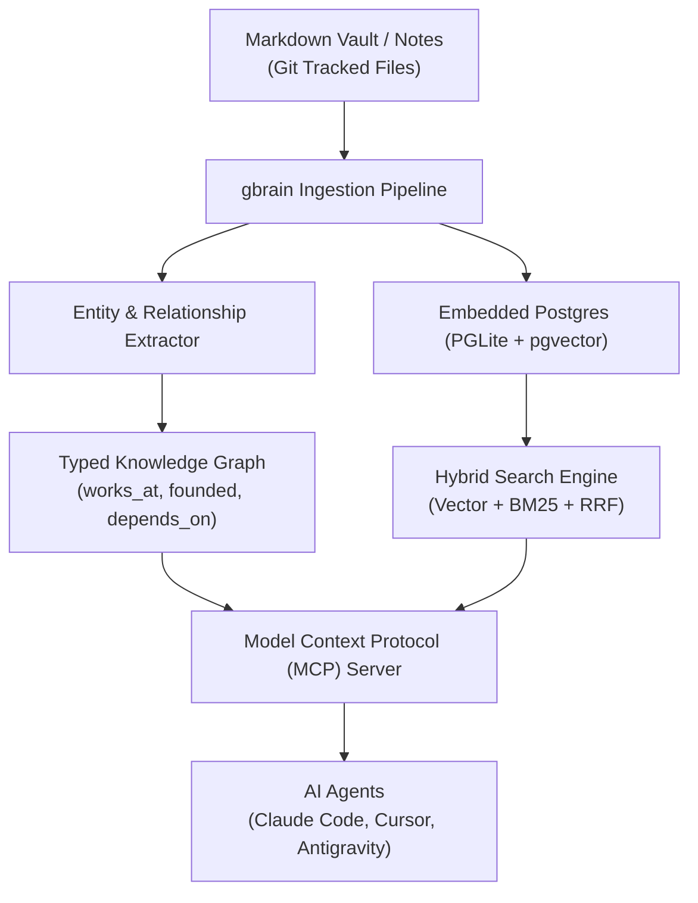

# gbrain Agent Memory & Knowledge Graph (`garrytan/gbrain`)

> **Priority:** `P1` | **Framework:** `garrytan/gbrain` | **Domain:** `09-autonomous-agents` | **Stars:** `⭐ 32k+`

Garry Tan's (Y Combinator CEO) open-source, markdown-first AI agent memory system and self-wiring knowledge graph layer. It serves as a persistent, private long-term memory backend across AI coding agents (Claude Code, Cursor, Antigravity, OpenClaw, Hermes Agent), combining human-readable markdown files with embedded PostgreSQL (`PGLite`/`pgvector`) and Model Context Protocol (MCP) tooling.

---

## When to Use

Activate this skill when:
- Equipping AI coding agents with a durable, cross-session second brain and knowledge graph.
- Maintaining markdown as the human-readable, Git-trackable single source of truth for notes, decisions, and system logs.
- Executing fast hybrid search across unstructured documents using Reciprocal Rank Fusion (RRF) combining dense vector embeddings and BM25 full-text search.
- Automatically extracting entities (people, companies, repos, technical concepts) and typed relationships without costly LLM loop overhead.
- Running background memory maintenance routines that asynchronously resolve contradictions, deduplicate notes, and update graph edges.

---

## Core Capabilities & Architecture



1. **Markdown-First Persistence**:
   - Stores knowledge in standard Markdown files within a Git repository. Human-editable, transparent, and completely vendor-independent.
2. **Embedded PGLite + pgvector**:
   - Runs an embedded WebAssembly/in-process PostgreSQL engine (`PGLite`) equipped with `pgvector` for instant setup without requiring an external database cluster.
3. **Hybrid Search (Vector + BM25 + RRF)**:
   - Fuses semantic embeddings with exact BM25 keyword matching using Reciprocal Rank Fusion (RRF), eliminating keyword blindness and semantic hallucination.
4. **Self-Wiring Knowledge Graph**:
   - Automatically maps entities (founders, companies, architectural decisions, code contracts) and typed edges into an explorable relationship graph.
5. **Model Context Protocol (MCP) Gateway**:
   - Connects directly to coding assistants via native MCP tools (`gbrain_search`, `gbrain_recall`, `gbrain_graph_query`, `gbrain_capture`).

---

## Activation Command

### Interactive Activation
```bash
/gbrain
# Or scoped agent command:
/agent-gbrain
```

### Installation & Quick Start
```bash
# Clone the repository:
git clone https://github.com/garrytan/gbrain.git
cd gbrain

# Install dependencies and build:
npm install
npm run build

# Initialize memory vault in current workspace:
npx gbrain init

# Ingest existing markdown notes into vector store:
npx gbrain sync ./docs
```

### MCP Server Configuration (`claude.json` / `settings.json`)
```json
{
  "mcpServers": {
    "gbrain": {
      "command": "npx",
      "args": ["-y", "gbrain-mcp", "--vault", "./docs"]
    }
  }
}
```

---

## Prerequisites

- Node.js 18+ or Python 3.10+ polyglot runtime.
- Directory of markdown documentation, decision records, or session notes.
- Git repository for tracking living knowledge.

---

## Anti-Patterns & Warnings

> [!WARNING]
> - **Binary Storage Trap**: Never store raw proprietary binary databases without keeping plain-text Markdown as the primary source of truth.
> - **Unchecked Contradictions**: Run `gbrain audit` periodically to identify diverging assumptions across older and newer markdown specs.
> - **Context Token Ingestion**: Prefer focused graph and hybrid queries (`gbrain_search`) over injecting entire documentation folders into prompts.

