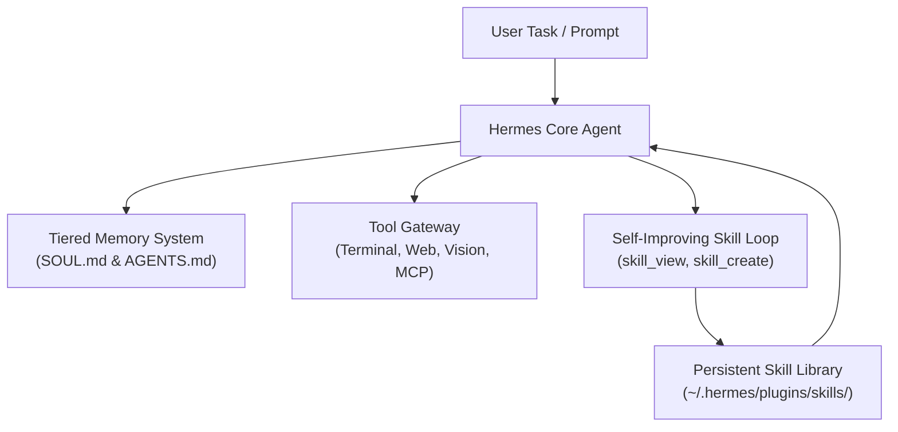

# Hermes Agent (`NousResearch/hermes-agent`)

> **Priority:** `P1` | **Framework:** `NousResearch/hermes-agent` | **Domain:** `09-autonomous-agents` | **Stars:** `⭐ 18k+`

Nous Research's open-source autonomous AI agent framework designed for local, server, and multi-platform deployment. Hermes Agent pairs advanced reasoning models (Hermes 3, local open weights, and cloud providers) with a self-improving skill creation loop, tiered persistent memory, and deep tool integration.

---

## When to Use

Activate this skill when:
- Deploying a self-improving autonomous agent capable of authoring, validating, and curating its own reusable skills across sessions.
- Requiring persistent, tiered cross-session memory (`~/.hermes/SOUL.md` and project-level `AGENTS.md`) that preserves user preferences and architectural patterns.
- Running multi-modal or terminal-bound agent tasks across diverse environments: Linux, macOS, WSL2, Windows, or cloud servers.
- Connecting autonomous agents to custom tool suites via Model Context Protocol (MCP) or built-in tool gateways (web browsing, vision, terminal).
- Developing model-agnostic workflows compatible with local Ollama/vLLM endpoints, OpenRouter, or Nous Portal.

---

## Core Capabilities & Architecture



1. **Self-Improving Skill Loop**:
   - Detects recurring multi-step solutions and dynamically authors new `SKILL.md` packages.
   - Refines and prunes existing skills using empirical feedback, turning single solutions into permanent institutional capabilities.
2. **Tiered Persistent Memory**:
   - *Global Tier*: `~/.hermes/SOUL.md` stores cross-project developer habits, tool preferences, and identity configurations.
   - *Project Tier*: Local `AGENTS.md` and session journals track architectural boundaries and repository laws.
3. **Multi-Platform Deployment & Gateway**:
   - Supports local terminal execution, background daemon service, and remote gateways (such as Telegram or Discord bots).
4. **Universal Tool & MCP Extensibility**:
   - Built-in tools for bash shell execution, web search, browser automation, and computer vision.
   - Native compatibility with Model Context Protocol (MCP) servers and Agent Skills open specifications.
5. **Model-Agnostic Engine**:
   - Optimized for Nous Hermes 3 / Hermes 4 reasoning models, but fully compatible with Claude, OpenAI, and local llama.cpp / vLLM inference.

---

## Activation Command

### Interactive Activation
```bash
/hermes-agent
# Or scoped agent command:
/agent-hermes-agent
```

### Installation & Quick Start
```bash
# Automated 1-line installation (Linux, macOS, WSL2):
curl -fsSL https://hermes-agent.nousresearch.com/install.sh | bash

# Or clone from source:
git clone https://github.com/NousResearch/hermes-agent.git
cd hermes-agent
pip install -e .

# Launch interactive CLI session:
hermes run
```

### Skill Management within Hermes
```bash
# Inspect active skills:
hermes skills list

# View skill definition:
hermes skills view <skill-name>

# Run background daemon:
hermes daemon start
```

---

## Prerequisites

- Python 3.10+ polyglot runtime or curl/bash installer.
- Local LLM inference backend (Ollama, vLLM, LM Studio) or an API key for OpenRouter, Nous Portal, Anthropic, or OpenAI.
- Git initialized in workspace with an `AGENTS.md` or `SOUL.md` file.

---

## Anti-Patterns & Warnings

> [!WARNING]
> - **Unbounded Autonomous Execution**: Always configure tool confirmation boundaries for destructive commands (`rm -rf`, database drops, git push force).
> - **Memory Poisoning**: Do not allow hallucinated facts or unverified assertions to persist into `SOUL.md` or `AGENTS.md`; audit long-term memory periodically.
> - **API Cost Spikes**: When configuring autonomous loops with commercial cloud APIs, enforce strict per-session token budgets and maximum iteration caps.

