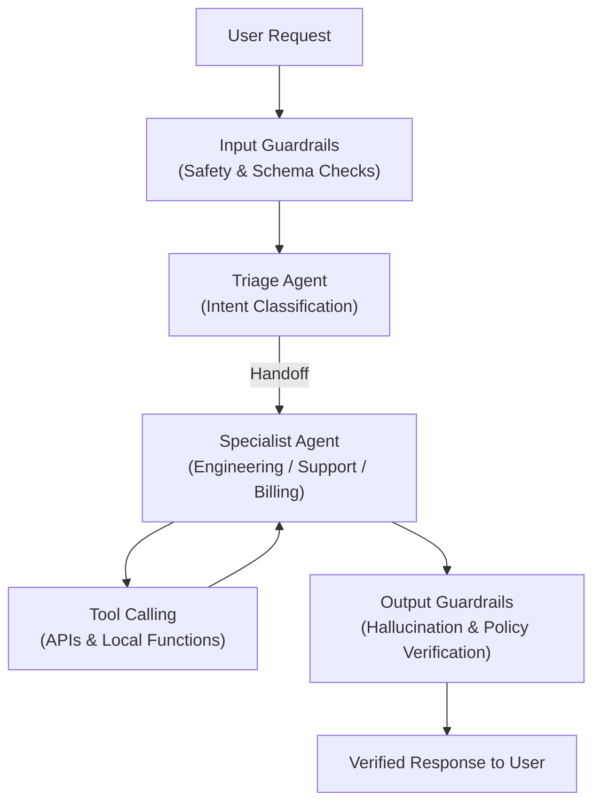

# OpenAI Agents SDK (`openai/openai-agents-python`)

> **Priority:** `P0` | **Framework:** `openai/openai-agents-python` | **Domain:** `09-autonomous-agents` | **Stars:** `⭐ 15k+`

OpenAI's official multi-agent orchestration SDK for Python. Designed to provide lightweight, composable, and observable abstractions for autonomous agent fleets, handoffs, input/output guardrails, and telemetry.

---

## When to Use

Activate this skill when:
- Designing multi-agent topologies where an orchestrator or triage agent delegates tasks dynamically to specialized subagents.
- Implementing safe agent-to-agent handoffs with seamless context transfer and execution control.
- Enforcing deterministic safety and compliance guardrails before agent execution or before returning responses to users.
- Requiring end-to-end tracing, latency profiling, and tool inspection out-of-the-box via OpenTelemetry.
- Building conversational customer support, research swarms, or hierarchical code generation workflows.

---

## Core Capabilities & Architecture



1. **Agent Primitive**:
   - Encapsulates system instructions, model selection, available tools, handoffs, and guardrails in a clean, self-contained object.
2. **First-Class Handoffs**:
   - Enables agents to transfer execution to other agents cleanly (`Agent.handoff(agent_b)`). The handoff carries conversational history, intermediate results, and tool outputs smoothly without context fragmentation.
3. **Guardrails Architecture**:
   - Pre-flight input guardrails filter malicious prompts or out-of-scope requests; post-execution output guardrails verify policy compliance and output formats.
4. **Native OpenTelemetry Instrumentation**:
   - Generates structured spans for every model call, tool invocation, and handoff event, integrating directly with Datadog, Honeycomb, or Arize Phoenix.
5. **Human-in-the-Loop & Approvals**:
   - Supports execution interrupts and human verification checkpoints for sensitive or destructive tool calls.

---

## Activation Command

### Interactive Activation
```bash
/openai-agents-sdk
# Or scoped agent command:
/agent-openai-agents
```

### Installation & Quick Start
```bash
pip install openai-agents
```

### Multi-Agent Handoff Example
```python
from agents import Agent, Runner, function_tool

# Specialist Agents
spanish_agent = Agent(
    name="Spanish Agent",
    instructions="You are a fluent Spanish assistant. Answer all questions in Spanish."
)

english_agent = Agent(
    name="English Agent",
    instructions="You are a fluent English assistant. Answer all questions in English."
)

# Triage Agent delegating via handoffs
triage_agent = Agent(
    name="Triage Agent",
    instructions="Determine the user's preferred language and hand off to the appropriate agent.",
    handoffs=[spanish_agent, english_agent]
)

# Run workflow
result = Runner.run_sync(triage_agent, "Hola, ¿cómo estás?")
print(f"Final Agent: {result.agent.name}")
print(f"Response: {result.final_output}")
```

---

## Prerequisites

- Python 3.10+
- OpenAI API key (`OPENAI_API_KEY`)
- Optional: OpenTelemetry exporter for distributed observability

---

## Anti-Patterns & Warnings

> [!WARNING]
> - **Circular Handoff Deadlocks**: Always set `max_turns` or recursion depth boundaries to prevent runaway agent delegation loops.
> - **Monolithic Agent Bloat**: Do not pack dozens of unrelated tools into a single agent; break responsibilities into focused specialists connected via handoffs.
> - **Unmonitored Tool Side-Effects**: Always configure confirmation guardrails for high-impact tools (e.g., payments, database deletions).

