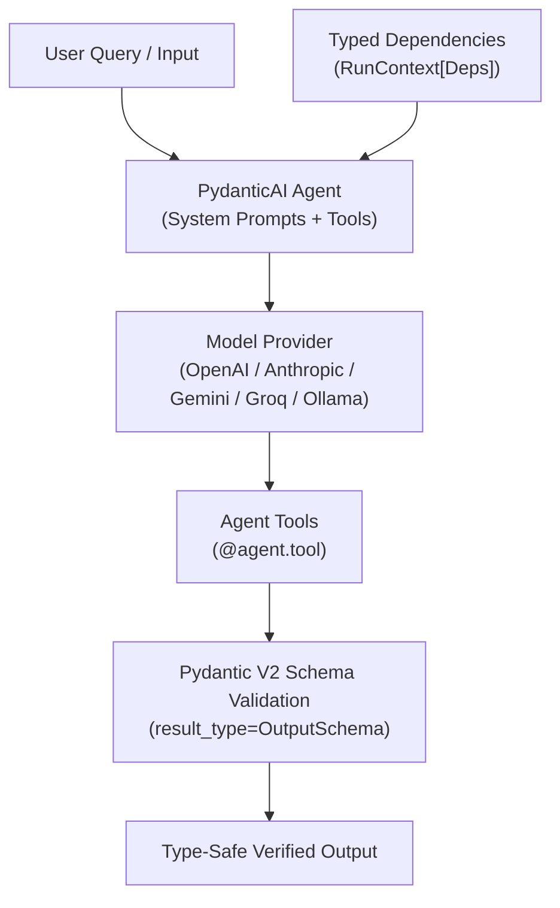

# PydanticAI Framework (`pydantic/pydantic-ai`)

> **Priority:** `P0` | **Framework:** `pydantic/pydantic-ai` | **Domain:** `09-autonomous-agents` | **Stars:** `⭐ 14k+`

Pydantic's official agent framework for building production-grade, type-safe Generative AI applications in Python. Built by the creators of Pydantic and FastAPI, it brings strict type validation, robust dependency injection, model-agnostic provider switching, and deterministic testing harnesses to AI agent architectures.

---

## When to Use

Activate this skill when:
- Developing production Python agents where LLM responses MUST strictly validate against Pydantic models.
- Safely injecting runtime dependencies (database connection pools, HTTP clients, user authentication state) into agent tools via `RunContext[MyDeps]`.
- Switching between multiple model providers (OpenAI, Anthropic Claude, Google Gemini, Groq, Ollama, DeepSeek) without changing application logic or tool definitions.
- Writing deterministic unit tests with `TestModel` or `FunctionModel` without burning API credits.
- Streaming structured output or real-time text responses with complete type safety.

---

## Core Capabilities & Architecture



1. **Type-Safe Structured Output**:
   - Define exact return types using Pydantic models (`result_type=MySchema`). The framework guarantees that the agent's output conforms to your schema or automatically prompts the model to self-correct validation errors.
2. **Typed Dependency Injection**:
   - Inject application state cleanly through `deps_type` and `RunContext[Deps]`. Tools receive live database connections, HTTP sessions, or API clients without resorting to global variables or fragile mocks.
3. **Model-Agnostic Engine**:
   - Native support for OpenAI, Anthropic Claude, Google Gemini, Groq, Mistral, Ollama, and any OpenAI-compatible endpoint. Switch providers via a single string identifier.
4. **Deterministic Testing & Evals**:
   - Built-in `TestModel` and `FunctionModel` simulate model responses for CI/CD pipelines, making agent unit testing fast, free, and completely deterministic.
5. **Streaming & Tool Augmentation**:
   - Supports async streaming of both text and structured objects, along with dynamic system prompts evaluated at request time.

---

## Activation Command

### Interactive Activation
```bash
/pydantic-ai
# Or scoped agent command:
/agent-pydantic-ai
```

### Installation & Quick Start
```bash
# Install core package with provider dependencies:
pip install pydantic-ai
# Or with specific providers:
pip install "pydantic-ai[openai,anthropic,gemini]"
```

### Minimal Agent Example
```python
from pydantic import BaseModel, Field
from pydantic_ai import Agent, RunContext
from dataclasses import dataclass
import httpx

class CityWeather(BaseModel):
    city: str = Field(description="Name of the city")
    temperature_c: float = Field(description="Temperature in Celsius")
    conditions: str = Field(description="Weather conditions summary")

@dataclass
class AgentDeps:
    http_client: httpx.AsyncClient

agent = Agent(
    'openai:gpt-4o',
    deps_type=AgentDeps,
    result_type=CityWeather,
    system_prompt="You are an expert meteorological intelligence agent."
)

@agent.tool
async def fetch_temperature(ctx: RunContext[AgentDeps], city: str) -> float:
    """Fetch current temperature for a city."""
    # Uses typed dependency client
    return 22.5

# Run with dependencies:
# result = await agent.run("What's the weather in Tokyo?", deps=AgentDeps(http_client=client))
# print(result.data.city, result.data.temperature_c)
```

---

## Prerequisites

- Python 3.10 or higher.
- Pydantic V2 (`pydantic>=2.7.0`).
- Model provider API keys (e.g., `OPENAI_API_KEY`, `ANTHROPIC_API_KEY`, or `GEMINI_API_KEY`).

---

## Anti-Patterns & Warnings

> [!WARNING]
> - **Unvalidated Regex Parsing**: Never manually parse JSON strings out of raw LLM completions; always use `result_type` to let Pydantic handle schema validation and automatic self-correction.
> - **Global State Pollution**: Avoid referencing global database connections inside `@agent.tool` functions; pass them through `deps_type` and `RunContext` for thread-safe concurrency.
> - **Untested Prompts**: Use `TestModel` in automated test suites to verify tool routing and dependency propagation without consuming API tokens.

