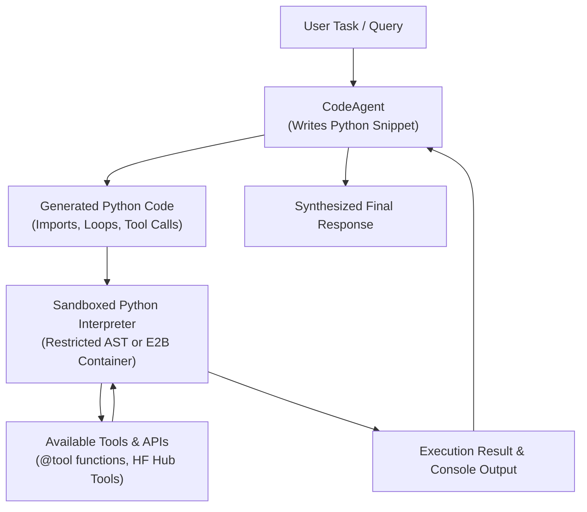

# smolagents (`huggingface/smolagents`)

> **Priority:** `P0` | **Framework:** `huggingface/smolagents` | **Domain:** `09-autonomous-agents` | **Stars:** `⭐ 42k+`

Hugging Face's minimalist, code-first AI agent library. Unlike traditional agent frameworks that force models to generate verbose, brittle JSON-RPC blobs, `smolagents` has agents write pure Python code snippets that are executed directly inside a secure, sandboxed interpreter—unlocking massive token efficiency, natural control flow (loops, variables, conditionals), and seamless Hugging Face Hub integration.

---

## When to Use

Activate this skill when:
- Building code-first AI agents where tool calls require loops, filtering, data transformations, or complex composition.
- Drastically reducing token consumption and latency by replacing multi-step JSON tool calling chains with concise Python code blocks.
- Running agent code safely in a sandboxed execution environment (local restricted AST interpreter or remote Docker/E2B sandbox).
- Leveraging Hugging Face Hub tools, datasets, and open-source models (Llama, Qwen, Mistral, DeepSeek) with minimal boilerplate.
- Architecting hierarchical multi-agent teams using `ManagedAgent` orchestrators.

---

## Core Capabilities & Architecture



1. **CodeAgent Architecture (Code > JSON)**:
   - Agents express multi-step actions as actual Python code. They can declare variables, iterate over search results, filter tabular data, and chain functions in a single turn without waiting for multiple round-trip JSON parses.
2. **Secure Sandboxed Execution**:
   - Executes code through a local AST-level restricted Python interpreter with fine-grained module whitelisting, or delegates execution to isolated E2B / Modal containers for untrusted production code.
3. **Extreme Token Efficiency**:
   - Solves complex orchestration problems in 30–50% fewer tokens compared to JSON-based frameworks by avoiding JSON schema serialization overhead.
4. **Hierarchical Multi-Agent Orchestration**:
   - Supports `ManagedAgent` delegation where a manager agent orchestrates specialized sub-agents (e.g., Web Researcher, Python Data Analyst, Code Verifier).
5. **Universal Model & Hub Interop**:
   - Works seamlessly with Hugging Face Hub inference, LiteLLM, Ollama, OpenAI, Anthropic, and vLLM.

---

## Activation Command

### Interactive Activation
```bash
/smolagents
# Or scoped agent command:
/agent-smolagents
```

### Installation & Quick Start
```bash
pip install smolagents
```

### Minimal CodeAgent Example
```python
from smolagents import CodeAgent, HfApiModel, tool

@tool
def get_stock_price(ticker: str) -> float:
    """Fetches the current stock price for a given ticker symbol.
    
    Args:
        ticker: The stock ticker symbol (e.g., 'AAPL', 'GOOGL')
    """
    prices = {"AAPL": 224.50, "GOOGL": 182.30, "MSFT": 415.20}
    return prices.get(ticker.upper(), 100.0)

# Initialize code agent with model
model = HfApiModel()
agent = CodeAgent(tools=[get_stock_price], model=model)

# Agent writes Python code to compute portfolio value in a single turn
result = agent.run("What is the total value of 10 AAPL shares and 5 GOOGL shares?")
print(result)
```

---

## Prerequisites

- Python 3.10+
- Hugging Face account / token (`HF_TOKEN`) or LiteLLM provider keys (OpenAI, Anthropic, etc.)
- Optional: E2B API key for sandboxed cloud execution

---

## Anti-Patterns & Warnings

> [!WARNING]
> - **Unrestricted Module Execution**: Never allow arbitrary `import` statements in production environments without strict AST whitelisting or container isolation.
> - **JSON Tool Forcing**: Do not force `ToolCallingAgent` when the problem involves loops or intermediate data storage; use `CodeAgent` for maximum reasoning speed.
> - **Ignoring Tool Docstrings**: Ensure tool functions have clear type hints and Google/NumPy-style docstrings, as the CodeAgent reads them to write accurate Python calls.

