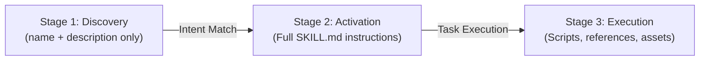

# Agent Skills Specification & Reference Toolchain

> **Priority**: `P0` | **Category**: `10-ai-infrastructure` | **Upstream**: [`agentskills/agentskills`](https://github.com/agentskills/agentskills) (27k+ ⭐) | **Docs**: [`agentskills.io`](https://agentskills.io/)

The foundational open specification and reference implementation (`skills-ref`) for Agent Skills. Standardizes how AI coding assistants (Anthropic Claude Code, OpenAI Codex, Cursor, Gemini CLI, Google Antigravity) discover, activate, and execute modular capabilities with minimal token overhead.

---

## When to Use

- Authoring, scaffolding, or validating new agent skills in any repository.
- Designing modular capabilities with token-conserving progressive disclosure.
- Linting and verifying `SKILL.md` frontmatter, schema, and directory layout using `skills-ref`.
- Generating `<available_skills>` XML blocks for injection into system prompts.

---

## Core Capabilities & Protocol

### 1. The 3-Stage Progressive Disclosure Lifecycle

Agent Skills conserve prompt context window by loading instructions dynamically across three stages:



1. **Discovery**: At session startup, the agent context receives only the skill `name` and `description` (~50–100 tokens per skill).
2. **Activation**: When user prompt matches a skill's description, the agent dynamically reads the complete `SKILL.md` file.
3. **Execution**: The agent follows the procedural steps, executing bundled code in `scripts/` or consulting files in `references/` as needed.

---

### 2. Standard Directory Layout

```text
my-skill/
├── SKILL.md          # REQUIRED: YAML frontmatter + procedural instructions
├── scripts/          # OPTIONAL: Executable helper scripts (bash, python, node)
├── references/       # OPTIONAL: Deep domain documentation, schemas, API guides
└── assets/           # OPTIONAL: Static templates, few-shots, exemplars
```

#### Required `SKILL.md` Structure:
```markdown
---
name: my-skill
description: "Clear, 1-2 sentence description explaining when and why the agent should activate this skill."
---

# Skill Title

Instructions and workflows...
```

---

### 3. `skills-ref` Official CLI Reference Tooling

The official Python reference implementation provides validation, inspection, and compilation utilities:

```bash
# Install skills-ref (Python 3.10+)
pip install skills-ref
# or via uv:
uv tool install skills-ref
```

#### Primary Commands:
- **Validate Skill Directory**:
  ```bash
  skills-ref validate path/to/skill
  ```
  Checks YAML frontmatter validity, missing descriptions, and broken path references.

- **Read Properties as JSON**:
  ```bash
  skills-ref read-properties path/to/skill
  ```
  Parses frontmatter and emits machine-readable JSON for agent harnesses.

- **Generate Prompt XML Block**:
  ```bash
  skills-ref to-prompt skills/01-core/* skills/10-ai-infra/*
  ```
  Compiles discovery metadata into formatted `<available_skills>` XML.

---

## Installation & Activation Command

To install third-party Agent Skills from any Git repository:
```bash
npx skills add https://github.com/agentskills/agentskills
```

To invoke specification guidelines in an assistant session:
```bash
/agent-skills-spec
```

---

## Prerequisites

- **Host Runtime**: Any Agent Skills-compatible harness (Antigravity, Claude Code, Codex, Cursor, Gemini CLI, OpenCode).
- **Tooling Runtime**: Python 3.10+ (for `skills-ref` validation CLI).

---

## Anti-Patterns & Warnings

- **Context Bloat**: Stuffing extensive reference documentation directly inside `SKILL.md` instead of delegating to a `references/` subfolder.
- **Vague Descriptions**: Writing weak descriptions like "Utilities for coding" instead of trigger-rich conditions ("Use when refactoring SQL queries or migrating PostgreSQL schemas").
- **Missing Frontmatter Delimiters**: Omitting opening or closing `---` triple hyphens.
- **Hardcoded Absolute Host Paths**: Using machine-specific paths instead of repository-relative anchors.

