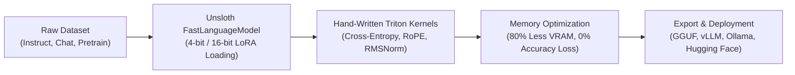

# Unsloth LLM Training & Inference (`unslothai/unsloth`)

> **Priority:** `P0` | **Framework:** `unslothai/unsloth` | **Domain:** `10-ai-infrastructure` | **Stars:** `⭐ 80k+`

Unsloth is the industry-standard, high-efficiency open-source LLM fine-tuning and inference acceleration library. By replacing PyTorch and CUDA kernels with custom hand-written OpenAI Triton GPU kernels and exact mathematical backpropagation derivations, Unsloth delivers 2x to 5x faster training speeds and cuts GPU VRAM consumption by up to 80% with 0% loss in mathematical accuracy.

---

## When to Use

Activate this skill when:
- Fine-tuning open-weights foundation models: Llama 3.3 / 3.2 / 3.1, Mistral, Gemma 2, DeepSeek-V3 / R1, Qwen 2.5 / 2.5-Coder, and Phi-4.
- Training models on consumer-grade GPUs (e.g., RTX 3090, 4090, T4, A10G) where standard Hugging Face/PyTorch runs hit Out-Of-Memory (OOM) errors.
- Implementing memory-efficient Parameter-Efficient Fine-Tuning (PEFT): LoRA, QLoRA (4-bit quantization via bitsandbytes), DPO (Direct Preference Optimization), and ORPO.
- Exporting trained LoRA adapters or merged 16-bit / GGUF quantized models for deployment with Ollama, vLLM, or LM Studio.
- Benchmarking inference throughput, latency, and tokens-per-second on local or cloud GPUs.

---

## Core Capabilities & Technical Highlights



1. **Hand-Crafted OpenAI Triton Kernels**:
   - Re-implements critical attention operations, RoPE embeddings, Cross-Entropy loss, and RMSNorm in manual Triton code, bypassing PyTorch overhead.
2. **Extreme Memory Efficiency (80% VRAM Reduction)**:
   - Enables fine-tuning 7B and 8B models on a single 16GB VRAM GPU with 4x longer context windows (up to 32k+ tokens).
   - Fine-tune 70B models on 48GB VRAM (e.g., 2x RTX 3090/4090 or single A6000/A100).
3. **Broad Architecture & Model Support**:
   - Native optimization for Llama 3.3/3.2/3.1, DeepSeek-R1-Distill, Qwen 2.5-Coder, Gemma 2, Mistral NeMo, and Phi-4.
4. **Preference Optimization & Alignment**:
   - Accelerated DPO (Direct Preference Optimization), PPO, and ORPO training loops with fast reward scoring.
5. **1-Click Model Export**:
   - Direct export to standard 16-bit float, 4-bit/8-bit GGUF (for Ollama and llama.cpp), and vLLM-compatible Hugging Face checkpoints.

---

## Activation Command

### Interactive Activation
```bash
/unsloth
# Or scoped infrastructure command:
/infra-unsloth
```

### Installation
```bash
# Conda / Pip installation with CUDA support:
pip install "unsloth[colab-new] @ git+https://github.com/unslothai/unsloth.git"
pip install --no-deps "xformers<0.0.29" "trl<0.13.0" peft accelerate bitsandbytes
```

### Python Fine-Tuning Example (`train.py`)
```python
from unsloth import FastLanguageModel
import torch

max_seq_length = 2048
dtype = None # Auto-detect Float16 or Bfloat16
load_in_4bit = True # 4-bit QLoRA memory savings

# 1. Load model with Unsloth Triton acceleration
model, tokenizer = FastLanguageModel.from_pretrained(
    model_name = "unsloth/Meta-Llama-3.1-8B-bnb-4bit",
    max_seq_length = max_seq_length,
    dtype = dtype,
    load_in_4bit = load_in_4bit,
)

# 2. Add LoRA adapters
model = FastLanguageModel.get_peft_model(
    model,
    r = 16,
    target_modules = ["q_proj", "k_proj", "v_proj", "o_proj",
                      "gate_proj", "up_proj", "down_proj"],
    lora_alpha = 16,
    lora_dropout = 0, # Unsloth supports 0 dropout for max speed
    bias = "none",
    use_gradient_checkpointing = "unsloth", # 30% longer context
)

# 3. Save to GGUF for local Ollama deployment
# model.save_pretrained_gguf("model_q4_k_m", tokenizer, quantization_method = "q4_k_m")
```

---

## Prerequisites

- Linux or Windows via WSL2 (Ubuntu 22.04+).
- NVIDIA GPU with compute capability 7.0+ (Turing, Ampere, Ada Lovelace, Hopper).
- Python 3.10+ and PyTorch 2.2+ with CUDA 11.8 or CUDA 12.1+.

---

## Anti-Patterns & Warnings

> [!WARNING]
> - **Non-Triton Fallback**: Ensure Triton is properly compiled; running on CPU or unsupported ROCm kernels forfeits speed and memory gains.
> - **Overfitting on Small Datasets**: Use modest rank (`r=8` or `r=16`) and monitor validation loss closely when fine-tuning code-specialized models.
> - **Tokenizer Mismatch**: Always save the matched tokenizer alongside model weights to prevent token decoding regressions in production inference.

