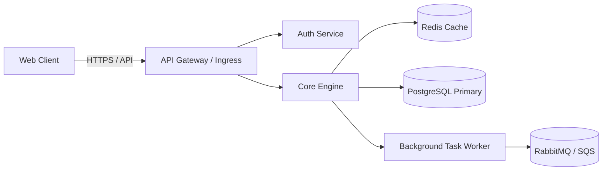
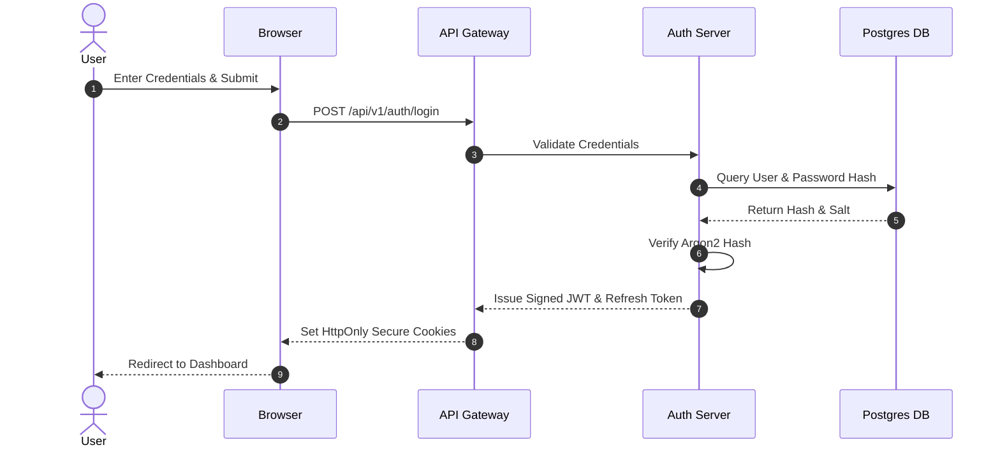

# Mermaid Technical Design & Architecture Generator (`/mermaid-design-generator`)

> **Domain:** 11 Project Documentation  
> **Upstream Authority:** [`spillwavesolutions/design-doc-mermaid`](https://github.com/spillwavesolutions/design-doc-mermaid) (⭐ 182, 92k+ Installs)  
> **Slash Command:** `/mermaid-design-generator`

---

## When to Use

* When authoring technical specifications (PRD, Architecture docs, ADRs) requiring clear, maintainable visual diagrams.
* When modeling distributed microservice flows, asynchronous event queues, user authentication sequences, or state transitions.
* When converting complex verbal system architectures into standard GitHub Flavored Markdown Mermaid charts.

## Prerequisites

* Markdown editor supporting Mermaid rendering (GitHub, VS Code, Notion, or Obsidian).
* Technical architecture specification or source code interfaces to diagram.

## Core Capabilities

1. **Architecture & Component Graphs**: Generates `flowchart TD` / `flowchart LR` showing service boundaries, databases, and APIs.
2. **Sequence Flow Modeling**: Produces `sequenceDiagram` visualizing synchronous RPCs, async webhook callbacks, and fallback paths.
3. **Finite State Machines**: Synthesizes `stateDiagram-v2` for lifecycle states (e.g. order processing, payment status, job queues).
4. **Entity-Relationship Schemas**: Diagrams relational database models with `erDiagram` showing primary and foreign key constraints.

## Activation Command

```bash
/mermaid-design-generator [flowchart|sequence|state|er] --doc <path> [--direction <TD|LR>]
```

## Workflow & Usage Guide

### 1. System Architecture Flowchart

````markdown

````

### 2. Authentication Sequence Diagram

````markdown

````

## Anti-Patterns & Warnings

* **Anti-Pattern:** Hardcoding unquoted special characters (parentheses, braces, brackets) inside node labels, breaking Mermaid parser compilation.
* **Anti-Pattern:** Overloading a single diagram with 50+ nodes; split complex architectures into bounded context sub-diagrams.
* **Warning:** Use supported diagram types (`flowchart`, `sequenceDiagram`, `stateDiagram-v2`, `erDiagram`) to ensure universal GitHub renderer compatibility.
