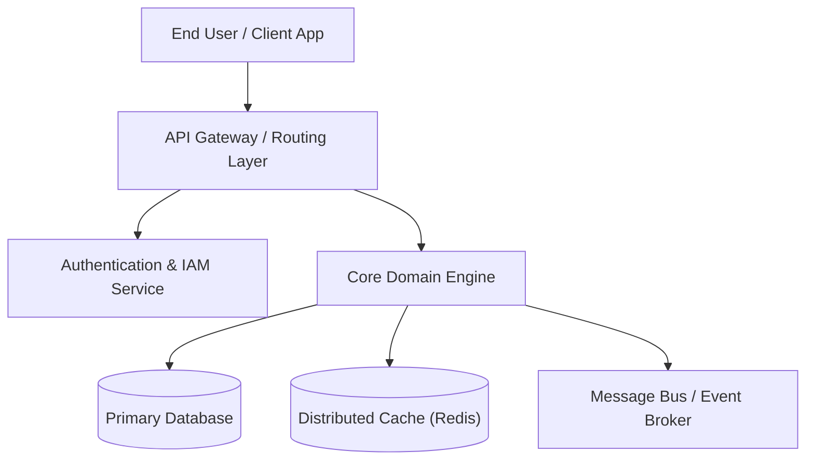

# System Architecture Document — {{PROJECT_NAME}}

> **Architecture Style:** Clean Architecture / Domain-Driven Design  
> **Status:** Active Architectural Blueprint  

---

## 1. High-Level System Context (C4 Context Diagram)

---

## 2. Subsystem Decomposition & Boundaries

### 2.1 Core Subsystems
1. **Gateway Layer (`gateway/`):** Handles TLS termination, rate limiting, and JWT validation.
2. **Domain Service (`services/`):** Pure business logic isolated from external frameworks.
3. **Storage Engine (`storage/`):** Abstractions for persistence, transactional consistency, and migrations.
4. **Transport Layer (`transport/`):** Network protocol encoders, serializes payloads into compact binary/JSON.

---

## 3. Data Flow & Communication Invariants
- **Synchronous Commands:** REST / gRPC with strict timeout budgets (< {{TIMEOUT_MS}} ms).
- **Asynchronous Events:** Event-driven architecture via {{EVENT_BROKER}} with at-least-once delivery.
- **State Mutation:** CQRS pattern separating read models from write commands.
