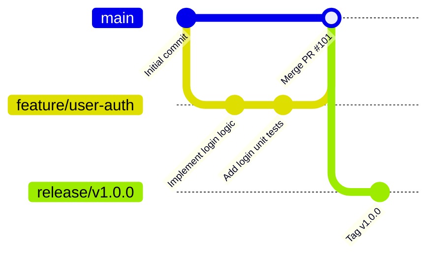

# Git Branching & Release Strategy — {{PROJECT_NAME}}

> **Standard:** Trunk-Based Development with Protected Main

---

## 1. Branch Strategy Diagram

---

## 2. Branch Naming Conventions
- `feature/<ticket-id>-<slug>`: New functionality
- `fix/<ticket-id>-<slug>`: Bug fixes
- `refactor/<slug>`: Code restructuring without feature change
- `docs/<slug>`: Documentation-only changes
- `release/v<semver>`: Release staging branch
