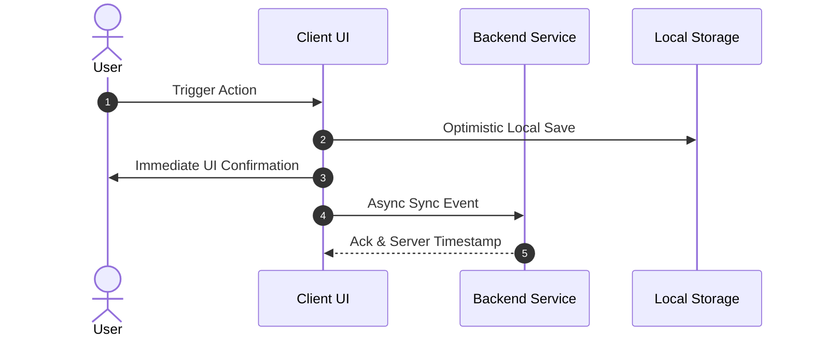

# Technical & UX Design Document — {{PROJECT_NAME}}

> **Author:** {{AUTHOR}}  
> **Status:** Approved Design  

---

## 1. Design Principles & Goals
1. **Low Cognitive Friction:** Minimal taps/clicks to complete core workflows.
2. **Graceful Degradation:** Full operational capability in offline or degraded network scenarios.
3. **Zero Data Loss:** Local-first queuing with optimistic UI updates.

---

## 2. Interaction Design & User Flows

---

## 3. Screen Layouts & Tactical UI Profiles
- **Profile A (Normal Mode):** Rich dashboard, full telemetry, visual analytics.
- **Profile B (Tactical / High Stress):** High-contrast monochrome, oversized touch targets, haptic feedback.
