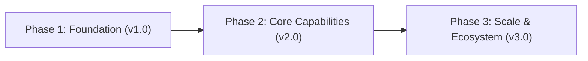

# Product & Engineering Roadmap — {{PROJECT_NAME}}

> **Last Updated:** {{DATE}}  
> **Strategy:** Phased delivery with strict Definition of Done gates.

---

## 🗺️ Milestone Horizon Map

---

## Detailed Milestone Gates

### Milestone 1: Foundation (v1.0) — Target: {{DATE_M1}}
- [ ] Core domain model and local persistence engine.
- [ ] Basic CLI / API interface contracts.
- [ ] Automated CI/CD with 90%+ unit test coverage.
- **Exit Gate:** All core acceptance tests passing; zero critical bugs.

### Milestone 2: Core Capabilities (v2.0) — Target: {{DATE_M2}}
- [ ] Real-time communication and multi-node synchronization.
- [ ] Production-hardened security and encryption layer.
- [ ] Cross-platform client apps (Android / Web / Desktop).
- **Exit Gate:** Benchmark verification passes load limits.

### Milestone 3: Ecosystem & Scale (v3.0) — Target: {{DATE_M3}}
- [ ] Third-party plugin SDK and external integration APIs.
- [ ] High-availability multi-region cloud clustering.
