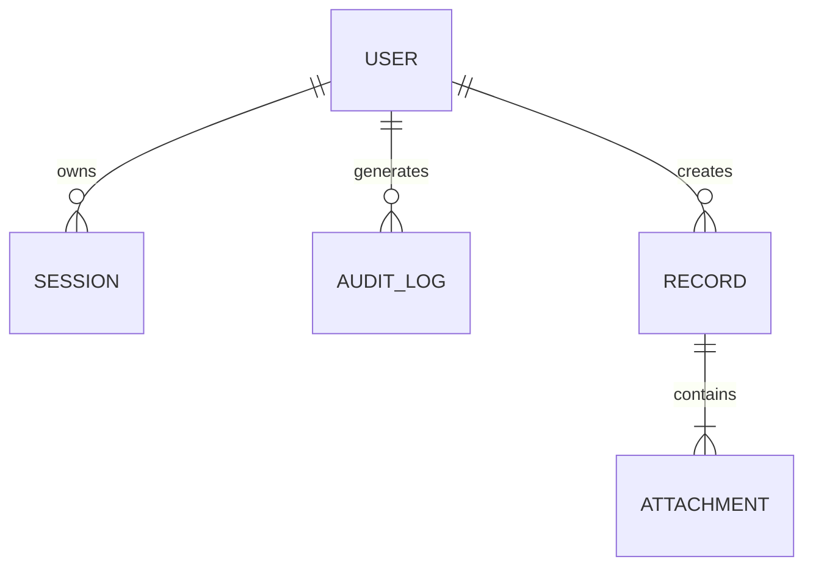

# Data Model & Schema Specification — {{PROJECT_NAME}}

> **Entities, Relationships, Ownership, and Migrations**

---

## 1. Entity-Relationship Diagram (ERD)

---

## 2. Schema Definitions

### 2.1 Table: `users`
| Column | Type | Constraints | Purpose |
| :--- | :--- | :--- | :--- |
| `id` | `UUID` | Primary Key, Not Null | Unique user identity |
| `email` | `VARCHAR(255)` | Unique, Indexed, Not Null | Account identifier |
| `role` | `VARCHAR(50)` | Not Null, Default 'user' | RBAC authorization role |
| `created_at` | `TIMESTAMP WITH TZ`| Not Null, Current Timestamp | Creation audit |

---

## 3. Data Retention & Privacy Invariants
- User sensitive personal data must be encrypted at rest with AES-256-GCM.
- Inactive temporary tokens must be purged every 24 hours.
